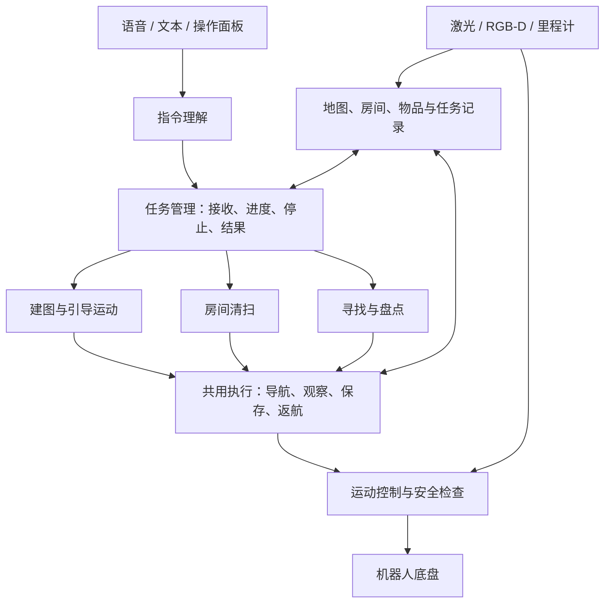

# 历史计划快照（仅供追溯）

2026-11-17里程碑重排前的原文。此快照不作为当前执行计划；唯一现行计划是 [DEPLOYMENT_PLAN.md](../DEPLOYMENT_PLAN.md)。实验记录和失败结论保留。

# 部署与开发总计划

更新：2026-11-17（四项必做功能与系统化开发复盘）。此文件是后续开发的唯一总计划入口。**本项目必须完成任务一、二、三、四，形成同一套家庭机器人系统：认识家庭环境、接受指令、清扫、寻物、统计和返回充电。** 先用当前配置完成任务三、四，再完成任务一、二；共用架构随主线逐步建设，四项功能完成后开展导航比较、视觉优化与创新功能。必要资源可以提前准备。

四项功能全部完成是用户已经明确的项目目标。现有开发从任务三、四起步，任务一、二同样属于必做功能；共用家庭场景、机器人、地图、导航、语音和记录系统。

## 0. 系统化开发复盘与总体设计

本节是2026-11-17的设计更新，没有启动新实验或实现下述新模块。用户要求沿用总计划，先完成四项功能，再做创新。过去的实验和阶段记录继续保留，开发顺序不因功能组织调整而推翻。

### 已有基础与当前程度

已有Ubuntu 22.04 / ROS 2 Humble / Fortress、家庭场景与基础测试场景、底盘/激光/RGB-D/TF、SLAM及地图保存、AMCL与Nav2。候选已细化相机支架、桌面目标和深度障碍输入。视觉主线为CPU YOLOv8n-seg、深度投影、地图坐标关联与去重。

| 系统能力 | 已有成果 | 下一块需要补齐的功能 |
|---|---|---|
| 建图与环境认识（任务一） | 激光建图、地图保存、房间命名、键盘入口；语音资源已准备 | 运动指令执行、全方向危险检查与拒绝/绕障、真实语音建图流程 |
| 房间清扫（任务二） | 房间多边形/入口配置、自主到房间、地图导航可复用 | 地面覆盖路线、按实际轨迹统计与补扫、返回任务起点、模拟充电、轨迹地图 |
| 单物体寻找（任务三） | 文本/JSON→房间导航→识别与定位→返回结果已实测 | 搜索覆盖及稳定性补齐，接通语音与统一调度 |
| 物品盘点（任务四） | 识别、编号、去重、计数、JSON/SVG/RViz标注已实测 | 扩展代表性布局和类别、完善观察覆盖、接通语音与系统流程 |

任务三、四是当前最成熟的业务能力；任务一有建图基础，任务二有导航基础。最近工程测试66项通过，5项隔离ROS测试另测通过；旧混合矩阵44/45通过，可靠输入批次27通过后因客户端发送前失败中止，剩余未补跑。这些状态用于安排下一步，不折算没有依据的完成百分比。中文“已找到/统计完成/未找到”已在 `search_node.py` 实现，之前对话列为待开发的说法在此纠正；统一进度提示和语音播报另行补齐。

### 一套机器人、四个功能入口

用户首先带机器人认识家庭并保存地图，之后直接说“清扫厨房”“去卧室找杯子”“统计客厅的瓶子”。机器人共用地图与房间信息，报告正在做什么、保存结果，并按任务需要返回起点。开发和展示均围绕这一连续使用过程组织。

图中任务管理、全系统运动仲裁及统一环境数据服务是拟建设模块；当前已有的搜索调度和记录将逐步接入，不要求重写底层导航与感知。

| 共用模块 | 负责的事情 | 逐步落地方式 |
|---|---|---|
| 指令入口 | 把用户表达转换成建图运动、清扫、寻找、统计、停止等明确动作 | 先统一文本/JSON规则，再接现有ASR；一条指令对应一个请求ID。旧 `/search/command` 保留适配入口 |
| 任务管理 | 检查运行条件、安排动作、报告进度、处理取消与结果 | 先采用明确状态机：空闲→检查→执行→收尾→完成/失败；用ROS 2 Action组织长任务的反馈与取消。初版单任务，后续增加队列和暂停恢复 |
| 环境数据 | 保存地图版本、房间边界/入口、初始位置、观察点及任务产物 | 同一坐标系贯穿四项功能。换地图后重新验证相关坐标；建图SLAM与导航AMCL由统一入口切换 |
| 共用动作 | 到入口、到指定位置、沿路线走、转向观察、保存地图、返回起点 | 将现有导航调用和记录逻辑封装复用；找一个物品和统计全部物品共用观察/识别/关联过程，结束条件不同 |
| 运动与安全 | 决定谁能控制底盘，检查行驶方向障碍和传感器状态 | 键盘、语音速度、Nav2均经过统一控制入口；停止优先。切换动作先停止并释放控制权，避免多个节点同时发有效速度 |
| 展示与记录 | 显示机器人、当前任务、路线、覆盖区域和物品；统一汇报 | 先整合现有RViz、中文日志和结果文件，再增加轻量控制面板；每次任务保存地图版本、输入、实际轨迹、耗时、结果和原因，并分别反馈执行结果与文件保存结果 |

清扫和物品观察共用路线执行、定位及记录，但各自计算完成情况：清扫依据地面实际扫过的面积，观察依据相机视野、遮挡与有效观测。两个结果在同一地图中叠加显示，方便后续融合。

### 组织实施与整机演示

1. **先稳定已有搜索能力**：补剩余矩阵和基础场景回归，把恢复后的启动条件重新记清楚；补代表性遮挡/邻房与定位检查，形成可重复使用的版本。
2. **随P3/P4建立共用系统入口**：将现有寻找/统计接入任务管理，统一请求、状态、取消、保存和地图版本；接语音，完成任务三、四演示/G0。不要先建设大而全框架，先让这两个真实业务使用起来。
3. **在P4a接入建图运动功能**：在同一入口增加运动词、速度控制、危险拒绝/受控绕障和地图保存，统一键盘/语音/Nav2控制权，完成任务一/G1。
4. **在P4b接入清扫功能**：由房间地图生成覆盖路线，复用共用动作执行，显示实际轨迹，补扫遗漏，返回记录的初始位置并显示模拟充电，完成任务二及整机G2。
5. **进行一次连续系统演示**：键盘/语音带领建图→保存并命名房间→切换日常工作模式→寻找物品→盘点物品→清扫房间→返回起点充电→查看同一地图上的物品与轨迹。各功能从统一入口操作，并展示停止及失败恢复。

覆盖路线优先采用适合当前房间的区域分解和往返扫描，用Nav2连接与跟踪，比较覆盖面积、遗漏、重复路程与转弯次数；这属于补齐清扫基本能力。底层导航/视觉替换和比较仍安排在四项功能完成之后。

### 完成四项功能后的创新主线

建议以“具有环境记忆、能够主动核验的家庭服务机器人”为主线，优先做下面前三项；断点续作和自然交互作为系统完善项逐步加入。这些是建议方案，效果需通过对照实验验证。

| 功能 | 用户能感受到的变化 | 如何利用现有基础 | 验证收益 |
|---|---|---|---|
| **持续更新的物品语义地图** | 可以查询物品上次在哪、何时看见；再次寻找优先前往有依据的位置 | 将每次任务的物品记录汇入持久数据库，保存类别、位置、房间、观察时间、图像证据与可信度；加物品与支撑面关系 | 对比无记忆搜索的耗时/路程；统计跨任务重复ID、错误合并、过期位置核验结果 |
| **主动观察与补看** | 目标被挡住或计数不确定时，自己换一个更合适的位置观察 | 从可达位置选择能看到更多未观察区域/疑似目标的视点，同时考虑绕行距离和图像质量 | 与固定视点比较召回、计数误差、遗漏区域、额外路程与任务耗时 |
| **清扫与环境观察协同** | 日常清扫顺便更新物品位置，后续寻物更快；需要时安排少量停靠观察 | 清扫执行时增加独立的观察记录通道，经过有价值位置时采集证据；先固定清扫路线附加观察，再研究路线联合优化 | 与分别清扫+巡查比较总路程/总耗时/地图新鲜度，同时核对清扫覆盖和识别质量 |
| 变化发现与家庭巡查 | 能提示“桌面新增一个瓶子”“之前记录的杯子需要重新查找” | 比较多次带时间的语义观测；先重新观察，排除遮挡和定位偏差再形成变化事件 | 变化检出率、误报率、确认耗时；相似物体身份不确定时保留候选关系 |
| 暂停恢复与自动续作 | 临时停止或模拟低电量返航后，继续未完成的清扫/观察 | 保存任务步骤、已覆盖区域和未执行动作；恢复前检查地图/定位，重新规划下一段 | 中断后完成率、重复清扫面积、恢复耗时；模拟电量有明确状态模型 |
| 有依据的自然语言交互 | 支持“找桌子上的杯子”“先清扫厨房，再统计瓶子”，结果可解释 | 查询已建立的房间/物品关系并编排已有动作；大模型可选，仅用于理解与组合，执行仍由任务管理检查 | 指令解析/任务成功率、错误动作率，以及回答能否追溯到实际观察 |

语义地图初版采用现有二维导航底图加三维物品位置和时间记录即可，不必先部署完整稠密三维重建。长期ID需关联外观、类别、位置和时间；移动的同类物品不能仅凭距离认定身份。家具/桌面关系需由标注或感知获得，场景生成真值仍只用于评估。动态障碍交给实时导航感知，持久地图保存经过核验的信息。

创新实验优先比较“每次从头搜→利用记忆→记忆加主动核验”，再比较“清扫和巡查分别执行→协同执行”。以实际任务的成功率、数量误差、路程/时间和地图更新质量证明价值；更换算法名称、加一个界面或简单标点本身不作为主要创新结论。

### 本次调研依据

- [Nav2 Humble的Simple Commander说明](https://docs.nav2.org/rolling/configuration_and_development/migration_guides/galactic/Galactic/)提供用Python组合导航任务的依据；共用动作服务可复用现有Action客户端，按需选择封装，不因此迁移ROS版本。
- [Open Navigation Coverage](https://github.com/open-navigation/opennav_coverage/blob/main/README.md)提供基于Fields2Cover的覆盖任务服务，README列出Humble相关分支。可参考其区域/条带/路线分层；室内家具与窄通道适配需要另测，本轮未安装或选定其为主线依赖。
- [ConceptGraphs论文](https://arxiv.org/abs/2309.16650)与[官方代码](https://github.com/concept-graphs/concept-graphs)提供物体及关系组成场景图的参考。本项目优先做轻量持久物品记录，关系查询后续增加；不声称已复现该系统。
- [Goal-Oriented Semantic Exploration](https://arxiv.org/abs/2007.00643)研究利用语义地图指导目标搜索。这里借鉴地图辅助搜索的思路，具体记忆时效、视点评分和清扫协同为拟设计、待测试方案。

## 1. 基线与变更边界

| 项目 | 当前基线 | 任务书验收前的约束 |
|---|---|---|
| 系统 | Ubuntu 22.04 / Humble / Fortress | 保持现有发行版，不为候选算法迁移系统 |
| 全局 / 局部导航 | NavFn Dijkstra / DWB | 主线继续使用；Smac / MPPI / RPP 仅准备依赖和比较方案 |
| 视觉 | `yolov8n-seg.pt` + RGB-D + 地图关联，CPU | 权重与视觉依赖保持；先补可见性、深度定位和稳定计数 |
| 场景 | `baseline` 和 `aws_house` | 保留原地图、房间配置、来源和验收记录；新布局/传感器版本独立保存 |
| 语言输入 | 文本 / JSON 规则入口 | 先完成执行功能；语音识别在基础功能后段接入，属于任务书必做；大语言模型可选、后置 |
| 任务组织 | 当前只实现寻物/计数调度 | 逐步增加语音建图、房间清扫模式，共用取消、状态、运动控制权与结果记录；新模式尚未实现 |

“沿用当前配置”不禁止必要的相机建模、外参调整、物品白名单、房间边界、搜索覆盖和障碍输入适配；这些属于任务书功能补齐，仍使用原导航与识别主线。每次影响几何/感知的修改都要单独标版本并回归。墙体/地面障碍改变后按需重新建图，不能直接套用旧布局地图。

## 2. 当前事实

- 已通过：实际仿真、雷达、RGB-D、TF、激光 SLAM、AMCL/Nav2；厨房单椅子搜索与四椅子计数/编号地图。
- 已有：文本/JSON 输入、取消、结果文件、地图标记；候选增加逐视点到达/停留/数据诊断和真实到达 TF。最新工程检查66项通过，5个隔离ROS客户端用例另行全部通过（默认套件跳过）。
- 候选已补：实体传感器组件、三房间桌面布局、必要深度障碍输入及主要失败反馈；尚缺代表性遮挡/邻房、独立冷启动、全房搜索覆盖和语音/人工全链路验收。
- 原房间矩形与地图保留；候选使用人工多边形和类别固定视点，不是自动房间分割，也没有覆盖率证明。
- 当前可调用类别仍为 chair / cup / bottle；新增资源暂存不会自动扩展运行白名单。目标分级见 [TARGET_CATALOG.md](TARGET_CATALOG.md)。
- 任务一已有激光建图、地图保存和基础运动组件；语音运动控制、完整危险指令拒绝/绕障闭环尚未实现。现有巡游脚本遇障停止不能替代这一验收。
- 任务二已有房间导航基础；房间全覆盖清扫、实际清扫轨迹导出、返航与模拟充电状态尚未实现。现有固定搜索视点不能视为清扫覆盖路线。

### 2026-11-16 自主开发增量（候选入口，尚未冻结演示版）

- P1：人工多边形、入口/连通、支撑面网格测量及独立三房间桌面布局已形成；原激光地图静态检查通过。新布局未重新 SLAM；充电位姿仍未验收。
- P2：1.0 m / 0.25 rad 的实体相机/支架组件、TF、相对材质缓存和专用点云坐标修复已实现；传感器复验通过。受控悬空箱未被激光看到但进入深度代价层，真实 Nav2 绕行通过一次，不能扩大为动态/全部高度的保证。
- P3：搜索支持类别专用观察点、不可达视点继续尝试、部分完成及覆盖限制。原蓝杯布局的厨房/客厅/卧室瓶子计数各通过一次；实际停靠时杯子经常被识别为 bowl，是当前主阻碍。降低相机、紧停靠容差及 960 输入均未解决，默认恢复原 640 输入，不引入新模型或伪造类别。
- 独立黄色杯子候选布局在原 640 配置下已完成三房间杯子 find + 杯/瓶 count 共 9 例首轮固定布局回归；全部数量正确、TF0。多次重复、多实例/空目标/异常、语音与全覆盖验收仍缺，不登记 G0。原场景、蓝杯布局与全部失败证据保留。现有 30 项回归及两个包构建通过；实测路径与最新运行状态见 [HANDOFF.md](../HANDOFF.md)。
- P4/G0、P4a/G1、P4b/G2 均未完成；本增量不改变原阶段顺序。用户已授权必要本地实验，P0 表格中“不启动功能实验”只描述当时预部署阶段。

### 2026-11-17 P3 续接

- 修复逐视点覆盖反馈：分别记录到达、完整停留和数据完整性；前一视点有帧不能掩盖后一视点无数据，局部缺口返回 partial。保留已确认对象及原任务级统计，明确迁移旧 observation_plan_completed 语义。
- 为卧室单独建立 v3 同位置双朝向候选，隔离短程往返引起的恢复；保留 v1/v2，原控制器/进度检查参数不变。实际到达 TF 与请求位姿分别保存，原地转向不等于多位置覆盖。
- 重复执行工具 `run_search_matrix.py` 固化每例5次清单、真实初始TF/odom、配置/权重散列、显式冷热启动说明和超时取消；预期数量只在结果后评估。新结果以 `docs/DEVELOPMENT_VALIDATION.md` 和 HANDOFF 最新批次为准；工具准备完成不等于所有45例、冷启动、语音或G0通过。
- 已实测逐视点断流返回partial。卧室早期15次warm任务通过；随后厨房批次发现客户端误收历史结果，矩阵检测重复ID后中止。保留失败记录，客户端改VOLATILE并排除既往ID，经隔离ROS测试后重跑全部45例；结果与版本边界记录在同一验证文档，不删失败或把机器人后续完成追认为客户端成功。

### 2026-11-17 停止时对照报告

按用户要求，完成最新的客户端订阅者就绪修复后停止；不启动后续实验。本节是既有计划的进度核对，不另开计划。当前主阶段仍是 **P3，G0/G1/G2均未达到**。

| 阶段 | 已完成/已有证据 | 与计划的差距 |
|---|---|---|
| P0 资源预部署 | 原依赖/权重、资产、语音环境已准备；技能目录和8个文件散列复核一致 | 已下载不等于开放类别或语音验收 |
| P1 场景与房间 | AWS住宅、独立桌面布局、人工多边形和评估真值；原场景/地图保留 | 充电点及完整可搜索区域未验收；不是自动分割 |
| P2 相机/覆盖 | 实体支架与相机、1m/.25rad外参、深度障碍适配；桌面实测和一次悬空箱绕行 | 全房/多遮挡覆盖、新相机椅子兼容和原场景物理回归待补 |
| P3 文本/JSON闭环 | 逐视点诊断、真实到达TF、有界补等、可选可靠订阅；修复旧结果误收及发现等待。工程66项+隔离ROS5项通过 | 旧45例44通过/1 partial；可靠输入新批27通过、1次未发指令的客户端失败、17例未执行；正式矩阵尚未闭合 |
| P4 / G0 | 既有任务三/四文本功能及JSON/SVG/标记证据 | 麦克风语音链路、人工/键盘建图演示、正式案例及报告未完成 |
| P4a / G1（任务一） | 已纳入同一计划；有SLAM和运动基础组件 | 语音运动、限速/超时/危险拒绝、受控绕障及完整建图闭环待开发 |
| P4b / G2（任务二） | 已纳入同一计划；有房间导航基础 | 地面覆盖规划、实际清扫轨迹、返航/模拟充电及四模式集成待开发 |
| P5/P6 探索 | 调研与资源准备保留 | 按约定仍后置，未开展导航算法/视觉模型比较 |

近期工作主要用于修复重复测试暴露的数据完整性与测试客户端问题，未切换NavFn Dijkstra+DWB、CPU YOLOv8n-seg权重/640阈值，未将场景真值用于搜索。可靠订阅短窗明显改善接收完整性，但底层原因和跨冷启动稳定性尚无结论。覆盖仍是配置视点，不保证全房所有物品可见。

最新完成项的[客户端修复与测试收据](evidence/client_discovery_fix_20261117.json)、[未发指令的原失败](evidence/client_discovery_failure_20261117.json)与[完整开发验证](DEVELOPMENT_VALIDATION.md)分别保留。工作区尚未提交/推送；停止检查未发现旧测试栈进程，不按旧PID执行终止。

恢复后顺序：重新启动并验证候选链路 → 另批补客厅瓶子与卧室20例并准确标记新的启动条件 → 新相机椅子兼容/原场景回归 → 遮挡邻房、冷启动、异常重复与定位标定 → P4语音/人工G0 → 任务一/G1 → 任务二/G2。当前停止，不执行上述后续项。

## 3. 阶段、产物与准入条件

| 阶段 | 工作 | 产物 / 完成条件 |
|---|---|---|
| P0 资源预部署 | 目标模型、相机描述、独立语音环境与离线权重；核对现有导航插件 | 固定版本、来源、许可、文件校验值和准备状态；不启动功能实验 |
| P1 场景与目标定义 | 明确目标实例和支撑面；房间细化为人工多边形，定义入口位姿、门口连接、禁行区域、初始/充电位姿及地图版本 | 可复现布局、底图叠加预览、独立评估真值；房间归属唯一，四类任务可复用空间配置 |
| P2 相机组件与覆盖 | 相机外壳、支架、碰撞体、质量惯性；校准高度、俯仰、视野、光学 TF；必要时补深度障碍输入 | SDF / TF 一致；地面、餐桌、茶几、卧室桌面多点可见性记录；通道及整体外形避障通过 |
| P3 文本/JSON 核心闭环 | 先验收椅子/杯子/瓶子，再逐类接纳物品；完成扫描、补视点、去重、计数与输出；明确共用任务状态和运动控制权接口 | 执行搜索案例矩阵；未观察/遮挡/无数据不混同为不存在；为新模式预留接口并回归原寻物功能 |
| P4 任务三、四完整验收 | 接现成语音转写与地点/物品解析；键盘建图演示、人工联调、报告/PPT和分工 | 语音→任务→导航→搜索→结果/地图真实完成；达到原 G0，冻结任务三、四演示版本 |
| P4a 任务一语音建图 | 先文本验证运动控制、限速、超时停车、危险拒绝和受控绕障，再接共用语音入口；运行 SLAM 并保存地图 | 完成任务一案例与地图产物，达到 G1；回归任务三、四及模式切换 |
| P4b 任务二房间清扫 | 先文本验证入口导航、房间覆盖规划、实际轨迹、返航和模拟充电，再接语音房间指令 | 完成任务二案例与覆盖/轨迹地图，达到 G2；四种模式分别演示并整理最终报告 |
| P5 导航比较 | 在冻结的地图/传感器/布局上比较 NavFn A*、Smac 2D、MPPI、可选 RPP | 保留 Dijkstra+DWB；单变量再组合对照；结果证明确有收益后才决定默认方案 |
| P6 视觉与其他拓展 | 同系列模型/微调、RT-DETR、开放词汇方案、长期语义地图、主动视点 | 独立环境/配置；同数据比较稳定性和成本；不覆盖 G0 已通过版本 |

依赖顺序：`P0 → P1 → P2 → P3 → P4/G0 → P4a/G1 → P4b/G2 → P5/P6`。保留原 P0–P6 编号，新增 P4a/P4b 承接任务一、二。G0 继续表示任务三、四完成，G1 表示任务一完成，G2 表示四项任务集成验收完成，避免把已有验收记录改成新的完成含义。

P1–P3 提前定义四项任务的共用数据和接口；任务一、二的功能实施在 G0 后推进。P0 可以提前进行；P5/P6 在 G2 前限于资料、依赖清点和方案设计，不运行算法比较、训练或替换默认配置。每个阶段先稳定文本/结构化执行，再做真实语音联调。

### 共用模块与模式切换

| 模块 | 统一设计及复用边界 |
|---|---|
| 房间与地图 | 同一地图版本关联房间多边形、入口、连通关系、观察点及起始位姿；清扫区域额外定义有效清扫宽度和可清扫地面，不用对象真值参与规划 |
| 命令入口 | 共用语音转写和规则解析，按建图运动、清扫、寻物、计数分派；保留现有 find/count/cancel 接口。现有语音节点直接发到 `/search/command`，后续才增加分派，当前不能直接发送新模式命令 |
| 任务状态 | 共用任务 ID、运行/取消/失败及原因，清扫另有部分覆盖、返航失败、模拟充电等状态；忙时明确拒绝新任务，切换需先取消当前动作并确认停车 |
| 运动控制 | 键盘、语音速度、Nav2 和恢复动作统一仲裁，同一时刻只有一个有效速度来源；停止优先，失联/超时停车。Nav2 的导航避障不能自动保护绕过它直接发送的速度指令 |
| 定位与建图 | 建图时由 SLAM 提供地图变换，使用已有地图导航时由 AMCL 定位；二者不得同时负责 `map → odom`。切换模式需检查定位、TF 和传感器是否就绪 |
| 记录与显示 | 共用场景/地图版本、任务状态、map 坐标（m）、仿真耗时与实际耗时记录；分别输出物体标记层、运动轨迹层与清扫覆盖层 |

共享房间与路线执行模块有助于减少重复开发；地面清扫覆盖和摄像机观察覆盖分别计算，桌面可见性仍按 P2/P3 验证。

### P4a：任务一实施与验收

1. 解析前进、后退、左转、右转、加速、减速、停止。为速度、持续时间和指令有效期设定可配置上限；缺少方向的加速指令不启动运动。先用文本验证，再接语音并记录转写/解析结果。
2. 根据运动方向、机器人轮廓和制动余量检查 `/scan`；后退检查后方，转弯检查扫过区域。扫描过期或数据不足时停车并反馈，不把无数据视作无障碍。
3. 遇到危险先停车，输出障碍距离/方向和拒绝原因，请求重新下达指令。绕障作为明确的受控动作：在当前已观测区域构造有边界的局部目标，经可通行性检查后交给导航执行；无可行路线则保持停车并反馈。停止指令立即取消绕障，受拒绝的旧速度指令不自动恢复。
4. 语音运动过程中使用 SLAM 构图，结束后保存新的 YAML/PGM 及运动轨迹、拒绝/绕障日志。使用独立地图文件名，保留原验收地图。
5. 验收覆盖全部运动词、速度上下限、重复/无效指令、前后障碍、转角障碍、传感器超时、可绕行与无路可绕、绕障中停止，以及完整语音建图和保存后的地图加载。

G1 要求有实际危险指令拒绝和成功绕障记录，不能只展示急停；最终地图须包含房间与障碍信息，并能重新加载。正式案例沿用第 5 节的重复运行、异常记录和人工语音验收原则。

### P4b：任务二实施与验收

1. 完成键盘控制建图和保存演示，复用命名房间配置；为厨房、客厅、卧室校准入口位姿。任务启动时记录有效的 map 系初始位姿，将其作为本次返航/模拟充电位姿；展示充电点与该位姿一致，定位无效时拒绝启动。
2. 从房间多边形和占据地图确定目标地面区域，结合机器人外形检查可达性，区分障碍、未知、静态不可达和可清扫区域。为仿真定义有效清扫宽度，先校准并冻结区域掩膜与覆盖判定容差。
3. 将不规则房间中的可清扫区域分解为适合往返行走的区域，生成覆盖路线，借助现有 Nav2 连接入口、各条清扫路线和返航点。以覆盖完整性、路径长度和重复面积评价路线；任务书所称“最优路径”需要明确优化指标，当前不承诺全局最优。
4. 按实际定位轨迹与有效清扫宽度累计已覆盖区域，不用规划路线或已访问路点数量代替覆盖率。保留固定的目标区域分母，分别报告被排除的静态区域和运行中未覆盖区域；临时堵路不能通过缩小分母变成完成。
5. 对绕障偏离后留下的空白区域补扫；无法补扫则报告部分完成及原因。结束后返回记录的起始位姿，达到位置/朝向容差并停稳后才进入模拟充电状态；返航受阻单独报告失败。取消默认停车，是否返航通过明确指令决定。
6. 发布实际路径供 RViz 显示，终端输出耗时；保存 `result.json`、实际轨迹和带清扫轨迹/覆盖区域的地图。结果包含房间、区域面积、覆盖率、重复率、路径长度、两种耗时、遗漏原因及返航/模拟充电结果。输出按场景、任务类型和任务 ID 分目录。

G2 验收覆盖三个房间、狭窄通道、家具遮挡、入口不可达、临时堵路、部分覆盖、取消、定位失效和返航失败；成功案例须覆盖事先声明的可清扫区域（按冻结的离散化容差），完成返航和模拟充电状态切换，轨迹/覆盖地图与日志一致。全覆盖判定、清扫宽度、返航容差在正式案例前标定记录，不以单次成功证明任意布局均可清扫。

任务二包含“回初始位置进行充电”。本项目先以仿真充电点及明确的充电状态实现和演示该行为，报告注明模拟边界，并在正式验收前核对课程对该表达的认可；真实触点对接和物理电池充电模型列为后续扩展。仅返回坐标且没有充电状态证据时，不能登记任务二完整通过。

## 4. 相机与支架开发清单

参考已暂存的官方相机描述，复用外观、碰撞/惯性和光学坐标组织方式，不引入真实相机驱动来替代 Gazebo RGB-D。

1. 先测量各房间支撑面与目标尺寸，再确定固定可配置高度/俯仰；不直接把一个候选高度当作已经适合所有房间。
2. 为相机本体、安装板和支架补 visual / collision / inertial；核对安装连接及整体通过高度。
3. 同步更新 Gazebo 外参和 TF；用实际 camera_info 核对内参、RGB/深度对齐、单位和时间戳。
4. 先固定姿态建立稳定基线，再评估是否需要云台。加云台属于额外设计，不抢占基本可见性验证。
5. 对地面和桌面分别检查可达视点、目标像素尺度、遮挡、深度有效性和多个方向的可见性；机器人走过地面不能证明看全桌面。
6. 抬高后核对整机碰撞与悬空障碍。二维激光只能看到一个平面；若需要深度点云输入，作为原 Nav2 代价地图的感知补齐处理。

## 5. 核心自动验收案例

| 维度 | 必须覆盖的案例 |
|---|---|
| 房间 | 厨房、客厅、卧室；杂物间作为额外回归区域 |
| 首批目标 | chair / cup / bottle，含单个与多个；兼容集逐类准入 |
| 放置高度 | 地面、餐桌、茶几、卧室桌面；明确目标与支撑面接触关系 |
| 观察条件 | 清晰、部分遮挡、邻近同类、跨视角重复看到、邻房可见但不得计入 |
| 空与异常 | 无目标、未观察区域、不可达、取消、导航未就绪、深度失效、TF失败 |
| 输出 | 状态、编号、数量、米制 map 坐标、耗时、逐帧关联、JSON/SVG/RViz 一致 |

先采用能覆盖这些因素的代表性案例，避免未经分析就做全笛卡尔组合。每个正式验收案例至少重复 5 次，记录冷/热启动和初始位姿；这是工程验收门槛，不是任意场景可靠性的统计证明。所有失败保留，不只保留成功一次的结果。

数量与编号按独立真值检查，真值仅供评估，不能输入识别、关联或搜索决策。定位记录均值/最大误差，并在单目标标定后按尺寸冻结工程阈值；可将家具最大 XY 0.30 m、小物体最大 XY 0.10 m 作为待标定确认的起始指标，不能写成老师原文要求或已达到的成绩。

搜索完成须明确两层语义：观察计划是否执行完、声明可搜索区域是否充分观察。遮挡/不可达区域需要补视点或输出不确定；未完整覆盖时不能把已确认数当成有保证的全房总数。

## 6. G0 / G1 / G2：分阶段完成门槛

G0 保留原任务三、四完成门槛，以下同时满足后进入 P4a：

- 当前 Dijkstra+DWB、当前 YOLO-seg 主线通过 P3 正式案例，无碰撞且数量/编号/输出正确。
- 房间命名、搜索扫描、桌面物品、空目标和异常处理均有真实证据，覆盖不足有明确反馈。
- 语音识别与任务关键词解析完成真实人工联调；键盘建图和任务三/四完整演示可复现。
- 地图、配置、依赖、权重、资产与实验结果可追溯，历史基础场景回归通过，报告材料齐备。

语音识别是要求书功能，大语言模型不是前置条件。不能因为“模型后置”而把语音留到任务书完成之后。

G1 在 G0 基础上，通过第 3 节任务一全部验收，随后进入 P4b。G2 在 G1 基础上，通过任务二覆盖、返航、模拟充电和轨迹地图验收，并回归四种模式的启动、停止、取消及控制权切换，补齐演示与报告。达到 G2 后进入 P5/P6；G0、G1、G2 均须记录所用配置、证据路径与未覆盖的能力边界。

## 7. 后置比较方案

导航按“NavFn Dijkstra+DWB → NavFn A*+DWB → Smac 2D+DWB → Dijkstra+MPPI → Smac 2D+MPPI”比较，RPP按需要作为跟踪对照。地图、摆放、目标点、传感器、速度限制、定位初始化和资源条件一致；先看成功率/碰撞，再看停靠精度、耗时、路径和平滑性、资源占用。插件存在不等于适配和实验通过。

视觉先完成固定类稳定性，再比较模型或微调。重点是整次任务的漏检、误检、重复计数、坐标与耗时；RT-DETR 默认检测框不能直接视作已有实例掩膜的等价替代；Grounded-SAM 等开放词汇方案保留为后续支线。

创新主线及对照实验统一见第0节“完成四项功能后的创新主线”：持久物品语义地图→主动核验与补看→清扫/观察协同，配合变化检测和任务续作。导航与视觉算法比较为这些系统能力服务，以实际成功率、效率和记录质量决定是否采用。

## 8. 部署与回退

资源准备状态见 [RESOURCE_PREPARATION.md](RESOURCE_PREPARATION.md)。当前启动方法仍见 [AWS_HOUSE.md](AWS_HOUSE.md)。新增目标/传感器阶段使用独立布局与输出目录，阶段验收后再发布为新的可选场景；这里尚未创建新场景启动 ID。

维护每个阶段的配置/依赖/资产清单和验收快照。几何变化校正地图与观察点，传感器变化复验 TF/内参/深度；涉及算法对比时保持同一场景版本。原 `maps/course_house.*`、`scenes/baseline/`、已有 AWS 地图和结果不得被准备步骤覆盖。

2026-11-09 已完成资源预部署记录；2026-11-14 本次仅更新现有计划及相关说明，融合任务一、二。此次没有实施新功能或开展仿真、录音、推理及算法比较实验；任务一、二仍为待开发/待验收状态。
