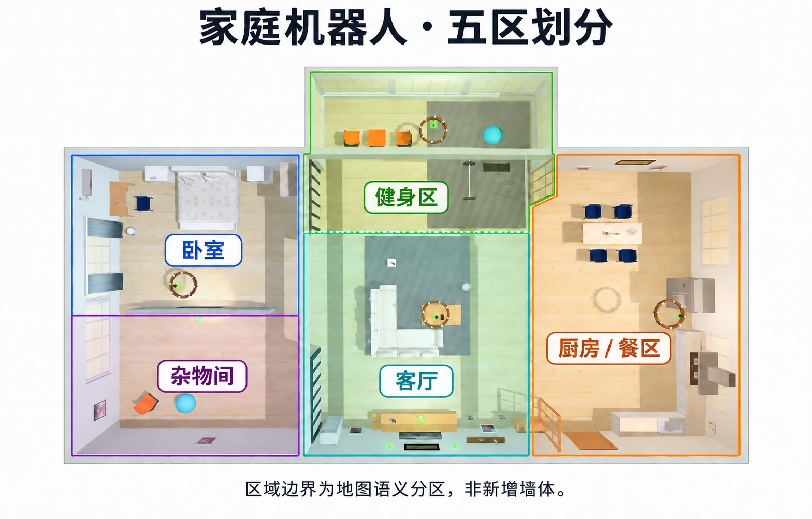
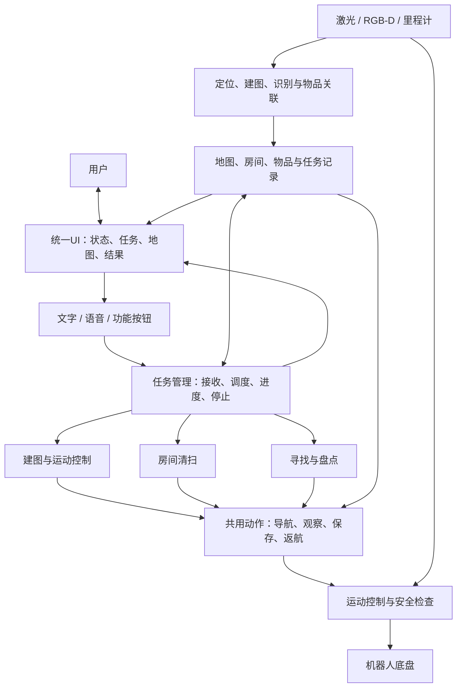

# 家庭机器人系统开发总计划

更新：2026-11-17。本文件是项目唯一总计划；完成情况以实际代码和验证记录为准。

五区：**卧室、杂物间、客厅、健身区、厨房/餐区**。中部以 `map y=1.0 m` 划分，下方客厅、上方健身区；分界是可穿越的语义线，没有新增墙体。上图由实际Gazebo俯视截图经imagegen标注，供阅读布局；精确范围以 [坐标图](../assets/house_five_zones_coordinates.png) 和 [v4配置](../../src/semantic_search/config/rooms_aws_house_v4.json) 为准。

## 1. 项目总目标与系统框图

开发一套具有统一操作界面的家庭服务机器人，**完整完成任务一至四：语音控制建图、房间清扫、单物体寻找、物品统计与地图标注**。系统共用地图、房间信息、导航、感知和任务管理，支持停止、结果保存及清扫后返回起点模拟充电。

机器人启动后自动打开本地UI，用户可以查看机器人状态和地图，通过文字、语音或功能按钮下达任务，看到执行进度、轨迹和结果。四项功能完成后，继续开发**持久语义地图、主动观察、清扫与观察协同**，使机器人能够积累家庭环境记忆并提高服务效率。

框图表示目标系统；下方里程碑标明哪些模块已经完成。典型使用过程：**带领建图 → 保存并命名房间 → 寻找/盘点/清扫 → 查看结果 → 返回充电**。

## 2. 开发里程碑

沿用已有编号：**P0 → P1 → P2 → P3 → P4/G0 → P4a/G1 → P4b/G2 → P5/P6**。已完成的基础能力直接复用；统一任务管理和UI在P4接入，随后随建图、清扫功能扩展。按用户最新要求，已先把P4的一键启动和搜索UI首版接通，P3正式验证仍继续收尾。P5与P6均在四项基本功能完成后开展。

状态仅使用“已完成 / 未完成”；一项包含实现和验证时，两者都完成才标记已完成。每个里程碑下已完成的工作保留勾选含义，未完成项继续开发，不按主观百分比计进度。

### P0：运行环境与资源准备

| 工作项 | 完成标准 / 产物 | 状态 |
|---|---|---|
| Ubuntu、ROS 2、Gazebo及工程构建 | Ubuntu 22.04、Humble、Fortress可运行，两个ROS包构建通过 | 已完成 |
| 导航、SLAM、视觉运行依赖 | Nav2、SLAM Toolbox、CPU YOLOv8n-seg及RGB-D处理可用 | 已完成 |
| 场景与目标资源 | 家庭场景、原基础场景、目标资产及相机参考已保存来源和版本 | 已完成 |
| 语音资源准备 | 独立语音环境与Whisper离线权重已准备 | 已完成 |

说明：本阶段完成资源准备；真实语音使用在P4验证。详情见 [资源准备记录](RESOURCE_PREPARATION.md)。

### P1：家庭场景、地图与房间信息

| 工作项 | 完成标准 / 产物 | 状态 |
|---|---|---|
| 家庭场景与原测试场景 | AWS住宅可运行，baseline场景及历史地图保留 | 已完成 |
| 激光建图与地图保存 | 已生成并保存YAML/PGM地图，能够加载定位导航 | 已完成 |
| 房间与桌面布局配置 | 厨房、客厅、卧室名称/范围；候选多边形、入口、连通及杯瓶布局 | 已完成 |
| 五区划分与操作接入 | v4明确边界、候选观察点、五区输入和地图轮廓/名称；静态检查及UI实测 | 已完成 |
| 房间入口与起点校准 | 三个房间入口、任务初始/充电位置在实际流程中验证 | 未完成 |

五区配置（2026-11-17）：一键启动、搜索解析和UI共同读取v4，四区v3保留。新分界两端为(-2.5, 1.0)、(4.8, 1.0)；共边由既有唯一归属规则处理，不设模糊过渡带。地图轮廓、名称和可切换观察点来自运行配置；五区完整感知覆盖仍需验证。实体隔断待后续设计，本轮不新增。

说明：已有地图由巡游建图获得，键盘/语音带领建图的完整演示分别纳入P4和P4a。

### P2：机器人相机与传感器组件

| 工作项 | 完成标准 / 产物 | 状态 |
|---|---|---|
| 雷达、RGB-D、里程计和TF | 真实话题数据、深度单位与坐标变换验证通过 | 已完成 |
| 相机和支架组件 | 候选外壳、安装板、支柱、碰撞与惯性；1m高度/.25rad俯仰及TF一致 | 已完成 |
| 深度障碍输入 | 点云坐标适配，接入候选Nav2代价地图；一次悬空障碍绕行已验证 | 已完成 |
| 多房间可见性与通行回归 | 地面/桌面、遮挡、狭窄通道，新相机椅子兼容和原场景回归 | 未完成 |

说明：当前保持固定相机方案，按实际可见性调整观察位置；整体测试完成后冻结传感器配置。

### P3：文本寻物与盘点核心功能

| 工作项 | 完成标准 / 产物 | 状态 |
|---|---|---|
| 文本/JSON任务与导航 | 解析房间/物品，执行寻找、统计和取消，自主到达观察位置 | 已完成 |
| 单物体寻找 | 已实测椅子和候选杯子搜索，输出中文结果及map米制坐标 | 已完成 |
| 去重、编号与计数 | 原场景椅子计数、候选杯瓶及双杯重复测试已有通过记录 | 已完成 |
| 结果与标记地图 | JSON、逐帧记录、SVG和RViz编号标记已有实测 | 已完成 |
| 数据诊断与客户端修复 | 逐视点状态、有界补等、可选可靠订阅、旧结果拒绝与发现等待已实现测试 | 已完成 |
| 正式案例与稳定性收尾 | 补剩余重复、独立冷启动、遮挡/邻房、异常重复及定位标定 | 未完成 |
| 搜索覆盖完善 | 补观察点或明确遗漏区域，验证房间中地面及桌面目标的观察充分性 | 未完成 |

说明：当前主开发位置在P3。首批使用chair/cup/bottle，之后按 [目标清单](TARGET_CATALOG.md) 分批增加兼容物品；已下载模型不自动计为已验证类别。

### P4：统一任务管理、UI与语音服务（G0）

| 工作项 | 完成标准 / 产物 | 状态 |
|---|---|---|
| 统一任务接口 | 请求ID、接收/拒绝、阶段进度、取消、执行结果与文件保存结果；兼容原搜索入口 | 未完成 |
| 统一启动与状态检查 | 一键启动UI、Gazebo、导航、视觉、搜索和RViz；实际数据就绪、退出清理已验证 | 已完成 |
| UI首版 | 状态、文字/选择任务、执行状态/耗时、停止、地图/物品标记、本次历史和结果文件 | 已完成 |
| 语音交互 | 麦克风→转写→房间/物品解析→执行→结果；UI显示识别文本和反馈 | 未完成 |
| 键盘建图与服务演示 | 实际键盘建图保存，语音寻找/统计，停止和失败反馈完整演示 | 未完成 |
| 任务三、四验收与版本保存 | P3正式案例及上述流程通过，配置、证据、运行说明齐备 | 未完成 |

说明：已用现有寻找/统计功能接通UI，支持请求幂等、单任务互斥、取消及结果保存反馈。完整统一任务接口仍未完成：后续补机器人阶段进度、建图/清扫动作与运动控制权；复杂队列随后扩展。本轮证据见 [一键启动验证](../evidence/oneclick_ui_20261117.json)。

### P4a：语音建图与统一运动控制（G1）

| 工作项 | 完成标准 / 产物 | 状态 |
|---|---|---|
| 运动指令 | 前进、后退、左转、右转、加速、减速、停止；速度/持续时间限制及超时停车 | 未完成 |
| 运动控制与障碍保护 | 键盘、语音、Nav2统一控制权；前后/转向检查，遇险停车、打印原因并请求新指令 | 未完成 |
| 受控绕障 | 有路时绕行、无路时反馈，绕障中可停止；不自动恢复已拒绝的旧指令 | 未完成 |
| 建图与导航切换 | 统一管理SLAM/AMCL、地图保存/加载和房间配置；避免重复发布地图变换 | 未完成 |
| UI建图操作 | 显示实时地图、运动状态和障碍反馈；提供运动、停止、保存地图操作 | 未完成 |
| 任务一完整验收 | 真实语音运动→危险处理/绕障→建图保存→重新加载，回归寻找/统计 | 未完成 |

说明：已有SLAM与地图文件在P1记录；此阶段将它们接入可完整操作的建图功能。

### P4b：房间清扫、返航与整机集成（G2）

| 工作项 | 完成标准 / 产物 | 状态 |
|---|---|---|
| 清扫任务与区域 | 解析目标房间，记录本次起点；从地图和房间多边形确定可清扫区域 | 未完成 |
| 覆盖路线 | 区域分解、往返扫描及Nav2连接/执行；减少遗漏、重复路程和转弯 | 未完成 |
| 实际覆盖与补扫 | 按实际轨迹和清扫宽度累计覆盖，绕障后补扫，未覆盖部分有记录 | 未完成 |
| 返航与模拟充电 | 返回本次初始位置、满足停靠容差、停稳并进入明确的模拟充电状态 | 未完成 |
| UI清扫操作与结果 | 选择房间，显示实际轨迹/覆盖/耗时/返航状态，保存轨迹地图与任务报告 | 未完成 |
| 四功能连续演示与报告 | 同一系统完成建图、寻找、统计、清扫和返航；验证切换/停止，整理报告与演示材料 | 未完成 |

说明：清扫宽度、覆盖判定和返航容差先标定再验收。模拟充电在UI明确标注，并在正式验收前核对课程认可。

### P5：导航优化比较

| 工作项 | 完成标准 / 产物 | 状态 |
|---|---|---|
| 导航比较 | 原Dijkstra+DWB对照A*、Smac 2D、MPPI等候选，记录成功率、停靠精度、路程/耗时 | 未完成 |
| 改进方案接入 | 在同地图/布局/初始条件下证实收益，回归四项功能后接入系统 | 未完成 |

说明：先完成G2，再开展导航替换或对比实验；原Dijkstra+DWB作为对照保留。

### P6：语义记忆、视觉优化与融合创新

| 工作项 | 完成标准 / 产物 | 状态 |
|---|---|---|
| 持久物品语义地图 | 跨任务保存物品ID、类别、位置、房间、时间和证据；UI可查询最后观测 | 未完成 |
| 主动观察与核验 | 根据历史记录和未观察区域选择下一视点，换角度确认目标或补计数 | 未完成 |
| 清扫与观察协同 | 清扫途中按需停靠观察并更新物品记忆，比较独立执行与协同执行效率 | 未完成 |
| 变化检测 | 多次观察确认新增、移动或待查物品，UI显示变化及图像依据 | 未完成 |
| 暂停恢复与续作 | 保存任务进度，恢复定位后继续；后续接入模拟低电量返航续扫 | 未完成 |
| 自然语言组合任务 | 支持位置关系查询及“先清扫再统计”等组合，调用已有动作并解释结果 | 未完成 |
| 视觉优化与类别扩展 | 比较模型/微调与候选物品的识别、计数、定位和运行成本，择优接入 | 未完成 |
| 创新实验与展示 | 对比无记忆/有记忆/主动核验，以及分别执行/协同执行，形成数据与演示 | 未完成 |

说明：优先完成前三项，再逐步完善后续功能。语义地图先采用二维底图加三维物品位置、关系和时间记录，充分利用现有感知成果。

## 3. UI功能设计

采用**本地浏览器控制界面**作为首版方案。统一启动入口启动系统后自动打开界面，机器人节点逐项就绪时更新状态；RViz保留为调试工具。用户日常通过UI完成输入、查看和结果导出。

| 界面区域 | 显示与操作 | 接入阶段 | 状态 |
|---|---|---|---|
| 顶部与系统状态 | 真实连接、仿真/视觉/定位就绪、5个组件状态 | P4 | 已完成 |
| 任务输入与停止 | 房间/物品选择、文字输入、开始/停止、忙碌和未就绪拒绝 | P4 | 已完成 |
| 地图与当前位置 | 占据地图、五区轮廓/名称、可选观察点、机器人位置/朝向、本次/历史结果的物品编号 | P4 | 已完成 |
| 执行与结果首版 | 执行状态、耗时、结果数量/坐标、观察限制、保存反馈与本次历史 | P4 | 已完成 |
| 逐步进度与语音 | 导航/观察阶段反馈、麦克风转写与可选相机画面 | P4 | 未完成 |
| 建图与清扫界面 | 房间范围、运动/保存地图、实际轨迹、覆盖和模拟充电状态 | P4a/P4b | 未完成 |
| 语义与变化视图 | 跨任务查询物品最后位置/时间、证据和变化记录 | P6 | 未完成 |

界面行为要求：

- 展示来自机器人后端的真实状态；数据失联显示“离线/过期”，没有电量来源时不虚构百分比。
- 一个任务从提交到结果使用同一ID；界面刷新或重连不重复发送任务，能够恢复查看当前执行状态。
- 未就绪功能显示原因并禁用启动；停止操作始终可见，执行结果由后端确认。运动保护在机器人侧持续生效。
- 搜索显示已观察位置及发现数量；清扫按实际轨迹显示覆盖率；统一显示耗时、失败原因及保存结果。
- 首版已完成状态、文字任务、地图与结果，接下来再接语音、建图和清扫操作；当前不显示虚构的电量、覆盖或细分步骤进度。

## 4. 执行与验收说明

1. **共用基础**：保持Ubuntu 22.04/Humble/Fortress、NavFn Dijkstra+DWB、CPU YOLOv8n-seg主线完成四项功能。相机、覆盖、障碍输入及兼容物品按需要完善。
2. **复用与保存**：保留原场景、地图、配置、权重和失败记录；新版本独立保存。地图、房间、物品和任务记录使用统一版本及map米制坐标。
3. **真实执行**：一次只有一个有效运动控制来源，停止优先；任务状态与结果文件保存状态都要反馈。更换地图后核对房间/物品坐标，SLAM与AMCL按模式切换。
4. **代表性验证**：三个房间、地面/桌面、单/多目标、重复观察、遮挡/邻房、空目标、不可达、取消、深度/TF失效。正式案例至少重复5次，记录冷热启动及初始位姿，定位阈值先标定后固定。
5. **按实际数据评估**：搜索检查观察充分性，清扫按实际轨迹计算覆盖；保留未完成区域。场景真值只用于设计和评估，不输入感知或任务决策。长期物品身份综合外观、类别、位置与时间核实。
6. **完整验收**：G0完成语音寻物/盘点及相关演示；G1完成语音建图与危险处理/绕障；G2完成清扫返航与四功能/UI连续使用。随后开展算法与创新对照实验。

## 5. 当前进度与下一步

**当前为P3正式验证收尾，同时已完成P4的一键启动和搜索UI首版。** 工程测试139项通过，5项隔离ROS客户端测试在本轮跳过（此前已通过）。两次GUI冷启动、传感器检查、寻物/计数、取消后恢复及退出清理已有本轮实测；浏览器地图、窄屏、刷新行为和任务控制也已检查。

这些是启动/UI集成证据，不替代P3正式稳定性和全房覆盖验收：旧45例仍为44通过、1次partial；可靠订阅新批27通过后发生1次未发指令的客户端失败，后17例未执行。

下一步：**复用一键入口 → 补剩余案例与新相机/原场景回归 → 完善观察覆盖 → 补任务阶段反馈和语音G0 → 建图G1 → 清扫和整机G2 → 优化与创新。**

| 查阅内容 | 位置 |
|---|---|
| 最新续接状态、实验配置和具体动作 | [HANDOFF.md](HANDOFF.md) |
| 任务书逐项核对 | [REQUIREMENTS_STATUS.md](REQUIREMENTS_STATUS.md) |
| 实验结果与失败证据 | [DEVELOPMENT_VALIDATION.md](DEVELOPMENT_VALIDATION.md) |
| 当前候选启动和任务命令 | [RUNNING.md](RUNNING.md) |
| 当前消息与输出契约 | [INTERFACES.md](INTERFACES.md) |
| 资源、依赖与参考项目 | [RESOURCE_PREPARATION.md](RESOURCE_PREPARATION.md)、[SOURCES.md](SOURCES.md) |
| 重排前的设计与验收细节，仅供追溯 | [历史快照](../archive/history/2026-11-17-plan-before-milestone-reformat.md) |

本次仅重排计划并加入UI要求，未增加新的实测结果。总计划持续更新各里程碑状态；长期日志保留在验证文档和历史记录中。
