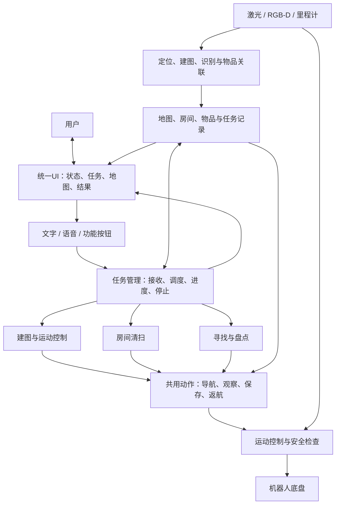

# 家庭机器人系统开发总计划

更新：2026-11-24。本文件是项目唯一总计划；完成情况以实际代码和验证记录为准。

### 当前交付取舍：以答辩素材为导向（2026-11-23）

展示完整系统，突出两三个有证据的亮点：**两区清扫与避障、两房间准确寻物计数、语义记忆引导查找与变化核验**。答辩使用提前整理的真实图片、视频和数据，长任务可加速或截取关键段。16类全面验收、全屋各分区清扫不再作为交付前提。

| 本次重点 | 范围与交付 | 当前缺口 |
|---|---|---|
| 四功能统一系统 | 语音建图、清扫、寻物、计数共用UI、地图、任务管理、停止、保存和回充 | 自动链路已有；真人四功能联调、版本与素材收尾待完成 |
| 两区清扫 | **卧室和杂物间均优化并形成完整素材**；保留均匀覆盖、受阻绕行与剩余处理 | 连续局部坐标＋侧向补扫后，卧室84.85%/19of19、杂物间92.74%/26of26，两区单次实际覆盖/无接触/时效/回充审计通过；散落球另测 |
| 清扫障碍场景 | 卧室展示已有家具旁通行；杂物间增加3–4个静置散落球，另验发现、绕行、继续清扫及可达残余补扫 | 用户确认与无新增球的完整清扫分两组证据；已实跑：检出/实走绕开/继续清扫/回充子项通过；旧79.68%/16of25仍partial，可达残余处理未完成；分阶段补扫实跑80.69%/20of27仍partial，补扫净增274格；针对选择效率的后续候选待复测 |
| 寻物与计数 | **厨房餐桌＋L形操作台、卧室书桌＋床头柜**；杯/瓶/椅基线，优先扩展厨房碗、卧室书 | 碗/书已各加2个，显式S1280/书辅助/v14近视点8项寻物计数及杯回归首轮通过；3布局/5重复未完成，仍为候选 |
| 综合避障 | 客厅较短路线→感知途中障碍→自主改走靠近健身区的北侧通路→原厨房任务→回充 | 同根无箱/放箱两次实际路线已核对，北侧绕行后原11点/2杯/回充通过；任务窗时效通过，首次无箱49次偶发超界仍未根因 |
| 语义亮点 | 一个正确的“历史记忆引导查找＋位置变化后现场核验更新”案例 | 厨房单杯移动后find1/count2、≤.20m/全11点/记忆更新/回充单轮通过，SQLite与真实Spark-DSG重载一致；完整收益对照与重复稳定性待完善 |
| 地图成果 | 同底图展示分区、物品、轨迹、覆盖、**导航代价**及关系图，输出可读素材 | 统一入口已实现7类空间视图＋真实DSG关系图PNG/SVG/原始JSON；同底图实数据出图通过，网页5种即时视图下载通过，观察任务HTTP另核对，清扫旧源离线＋隔离HTTP及新partial清扫真实HTTP导出均通过 |

基线、历史地图和失败保留；本计划只记录当前安排，逐轮实验查[验证概览](DEVELOPMENT_VALIDATION.md)。展示采用真实完整执行结果并注明版本，不把旧案例或单次成功称为当前配置稳定通过。

五区：**卧室、杂物间、客厅、健身区、厨房/餐区**。中部以 `map y=1.0 m` 划分，下方客厅、上方健身区；分界是可穿越的语义线，没有新增墙体。上图由实际Gazebo俯视截图经imagegen标注，供阅读布局；精确范围以 [坐标图](../assets/house_five_zones_coordinates.png) 和 [当前v6配置](../../src/semantic_search/config/rooms_aws_house_v6.json) 为准。

## 1. 项目总目标与系统框图

开发一套具有统一操作界面的家庭服务机器人，**完整完成任务一至四：语音控制建图、房间清扫、单物体寻找、物品统计与地图标注**。系统共用地图、房间信息、导航、感知和任务管理，支持停止和结果保存。按2026-11-21用户补充要求，固定充电处同时作为出生点，各正常任务结束后共用返航与模拟充电；C031已实现并完成五区及建图恢复后的回充子检查，完整清扫覆盖和连续稳定性仍待验收。

机器人启动后自动打开本地UI，用户可以查看机器人状态和地图，通过文字、语音或功能按钮下达任务，看到执行进度、轨迹和结果。本次重点完善**持久语义记忆、记忆引导查找和变化核验**；主动补充观察已有实现，是否改善识别按实际对照说明，清扫观察协同列后续。

框图表示目标系统；下方里程碑标明哪些模块已经完成。典型使用过程：**带领建图 → 保存并命名房间 → 寻找/盘点/清扫 → 查看结果 → 返回充电**。

## 2. 开发里程碑

保留 **P0 → P1 → P2 → P3 → P4/G0 → P4a/G1 → P4b/G2** 及P5/P6编号。P1–P3原冻结三类基线、P4/G0和P4a/G1自动验证已通过；当前以顶部范围完成代表案例和素材。已实现、单次实跑、正式稳定验收分别记录，不按主观百分比计进度。

物品以厨房和卧室两处支撑面为重点，正式默认仍为杯/瓶/椅；优先验证碗/书，其他好检测类别仅在完整识别、定位、去重和回充实测支持时增加。16类目录保留为后续扩展，不再设置8类/12类阶段冲量。

每个选定正式物品案例沿用5次重复并包含冷启动；所选扩展类别沿用至少3份独立变化布局，可在同一房间两处支撑面变换位置、方向和数量。数量梯度合并在布局中，不展开所有类别×房间组合。先解决数量/定位错误、碰撞、停车及返航问题，单项排查无进展时保留诊断并切换其他可推进项。

真人麦克风可在文本预检后联调，不等待全面类别或全屋清扫。导航算法比较及其他拓展暂缓。

### P0：运行环境与资源准备

| 工作项 | 完成标准 / 产物 | 状态 |
|---|---|---|
| Ubuntu、ROS 2、Gazebo及工程构建 | Ubuntu 22.04、Humble、Fortress可运行，三个ROS包构建通过 | 已完成 |
| 导航、SLAM、视觉运行依赖 | Nav2、SLAM Toolbox、YOLOv8n-seg及RGB-D处理可用；GPU已接入，CPU基线保留 | 已完成 |
| 场景与目标资源 | 家庭场景、原基础场景、目标资产及相机参考已保存来源和版本 | 已完成 |
| 语音资源准备 | 独立语音环境与Whisper离线权重已准备 | 已完成 |

说明：本阶段完成资源准备；真实语音使用在P4验证。详情见 [资源准备记录](RESOURCE_PREPARATION.md)。

### P1：家庭场景、地图与房间信息

| 工作项 | 完成标准 / 产物 | 状态 |
|---|---|---|
| 家庭场景与原测试场景 | AWS住宅可运行，baseline场景及历史地图保留 | 已完成 |
| 激光建图与地图保存 | 已生成并保存YAML/PGM地图，能够加载定位导航 | 已完成 |
| 房间与桌面布局配置 | 厨房、客厅、卧室名称/范围；候选多边形、入口、连通及杯瓶布局 | 已完成 |
| 五区划分与操作接入 | v4明确边界、候选观察点、五区输入和地图轮廓/名称；静态检查及UI实测 | 已完成 |
| 区域连接与起点校准 | 五区连接往返及起点共21次到点通过，误差符合0.12m/0.1rad；返航停靠在P4b验收 | 已完成 |

当前一键启动、任务解析和UI共同使用v6房间配置及service_surfaces_v2布局，厨房与卧室均包含两处必巡区域；旧配置保留。五区为语义分区，边界不新增实体墙。

说明：已有地图由巡游建图获得，键盘/语音带领建图的完整演示分别纳入P4和P4a。

### P2：机器人相机与传感器组件

| 工作项 | 完成标准 / 产物 | 状态 |
|---|---|---|
| 雷达、RGB-D、里程计和TF | 真实话题数据、深度单位与坐标变换验证通过 | 已完成 |
| 相机和支架组件 | 候选外壳、安装板、支柱、碰撞与惯性；1m高度/.25rad俯仰及TF一致 | 已完成 |
| 深度障碍输入 | 点云坐标适配，接入候选Nav2代价地图；一次悬空障碍绕行已验证 | 已完成 |
| 多房间可见性与通行回归 | 地面/桌面、遮挡、狭窄通道，新相机椅子兼容和原场景回归 | 已完成 |

说明：固定相机方案及传感器配置已完成本轮验证；观察位置按实测校准。新增布局聚焦厨房/卧室两处支撑面及杂物间清扫障碍；原布局保留，书/碗在所选案例通过前仍为候选。

### P3：文本寻物与盘点核心功能

| 工作项 | 完成标准 / 产物 | 状态 |
|---|---|---|
| 文本/JSON任务与导航 | 解析房间/物品，执行寻找、统计和取消，自主到达观察位置 | 已完成 |
| 单物体寻找 | 已实测椅子和候选杯子搜索，输出中文结果及map米制坐标 | 已完成 |
| 去重、编号与计数 | 原场景椅子计数、候选杯瓶及双杯重复测试已有通过记录 | 已完成 |
| 结果与标记地图 | JSON、逐帧记录、SVG和RViz编号标记已有实测 | 已完成 |
| 数据诊断与客户端修复 | 逐视点状态、有界补等、可选可靠订阅、旧结果拒绝与发现等待已实现测试 | 已完成 |
| 五区感知验证 | 核对各区可观察目标，补健身区、杂物间寻找/计数及空目标案例 | 已完成 |
| 正式案例与稳定性收尾 | 分配置补剩余重复、独立冷启动、遮挡/邻房、异常重复及定位标定 | 已完成 |
| 搜索覆盖完善 | 补观察点或明确遗漏区域，验证房间中地面及桌面目标的观察充分性 | 已完成 |
| 展示类别扩展 | 优先厨房碗、卧室书，按实际端到端准确率选择；通过所选案例后接入正式调用 | 未完成 |
| 两房间观察策略 | 厨房餐桌/操作台、卧室书桌/床头柜均检查，校准可达点位与互补朝向 | 未完成（必巡已接入，效率与计数稳定性待完善） |
| 多位置与数量验收 | 围绕所选厨房/卧室类别验证支撑面、位置、数量、去重与布局变化，每个正式案例重复5次含冷启动 | 未完成 |
| 变化布局搜索覆盖 | 根据实际传感器观察和已知地图补充扫视，记录未观察与不可达位置，在独立摆放用例上核对计数充分性 | 未完成 |

三类目标原冻结基线已通过：五区连接/起点21次，正式100次分批案例及57项遮挡/异常检查；不代表任意摆放或当前新布局通过。[基线收据](../evidence/p123_gpu_acceptance_20261118.json)

**本轮搜索策略验收：** 每个点位有可达性、实际RGB-D视野和目标支撑面依据；采用若干互补点位和必要朝向，避免同点机械旋转及无效重复。当前厨房同点8朝向仍待评估，不仅修改UI标签。计数必须完成所选类别全部有效巡视，不因早期找到目标或达到预期数量提前结束；寻物可在满足必巡后确认返回。校准布局与独立变化布局分开，检查双物体相邻、跨视角重复、遮挡、空目标、定位和回充。数量与位置来自现场感知，区域安排不成为硬编码答案。[物品清单](TARGET_CATALOG.md#5-物品验收清单)

### P4：统一任务管理、UI与语音服务（G0）

| 工作项 | 完成标准 / 产物 | 状态 |
|---|---|---|
| 搜索任务接入 | 请求幂等、接收/拒绝、单任务互斥、取消、结果与保存反馈 | 已完成 |
| 共用任务记录与搜索进度 | 统一任务状态、结果及文件链接，网页显示实际导航、观察、等待数据和保存阶段 | 已完成 |
| 统一启动与状态检查 | 一键启动UI、Gazebo、导航、视觉、搜索和RViz；实际数据就绪、退出清理已验证 | 已完成 |
| UI首版 | 状态、文字/选择任务、执行状态/耗时、停止、地图/物品标记、本次历史和结果文件 | 已完成 |
| 离线语音入口 | 网页录音、Whisper 转写和可编辑确认，复用文字任务接口 | 已完成 |
| 真人麦克风验收 | 四功能链路预检后由用户验证录音、转写、确认、执行、停止和失败反馈；不等待全面类别或全屋清扫 | 未完成 |
| 键盘建图、保存与重载 | 键盘控制仿真底盘，SLAM 保存新地图并重载，核对栅格一致及原地图完整性 | 已完成 |
| 任务三、四验收与版本保存 | P3正式案例及上述流程通过，配置、证据、运行说明齐备 | 未完成 |

说明：网页以请求 ID 对应机器人任务与进度。语音转写先填入指令框，由用户确认后执行。建图和清扫在 P4a、P4b 接入共用任务记录和运动控制。自动验收见 [P4阶段收据](../evidence/p4_g0_20261118.json)。

### P4a：语音建图与统一运动控制（G1）

| 工作项 | 完成标准 / 产物 | 状态 |
|---|---|---|
| 运动指令 | 前进、后退、左转、右转、加速、减速、停止；速度/持续时间限制及超时停车 | 已完成 |
| 运动控制与障碍保护 | 键盘和语音共用建图运动节点，建图期间停用 Nav2；遇险停车、打印原因并请求新指令 | 已完成 |
| 受控绕障 | 小箱可绕，宽屏障和未探索通道拒绝；绕行中取消后停车 | 已完成 |
| 建图与导航切换 | SLAM 与 AMCL 按模式切换，新图保存并独立重载，恢复原五区地图后验证寻找和统计 | 已完成 |
| UI建图操作 | 显示实时地图、运动状态和障碍反馈；提供运动、停止、保存地图操作 | 已完成 |
| 任务一完整验收 | 先以文本和合成音频完成运动、绕行、地图保存重载及回归，最后补真人麦克风联调 | 未完成 |

确认语音转写后执行短时运动。遇障停车并等待新指令，绕行检查已知空闲区域和当前激光。返回导航恢复已校准的默认地图。真人麦克风随最终整机联调统一验收。[P4a 阶段收据](../evidence/p4a_g1_20261118.json)

### P4b：房间清扫、返航与整机集成（G2）

| 工作项 | 完成标准 / 产物 | 状态 |
|---|---|---|
| 清扫任务与区域 | 解析目标房间，记录本次起点，从地图和房间多边形确定可清扫区域 | 已完成 |
| 两区覆盖路线 | 优化卧室/杂物间的均匀条带、连接与转弯，形成两个完整展示案例 | 部分完成 |
| 清扫中避障与补扫 | 两区家具旁安全通行；杂物间新增静置球，检出、绕行、继续清扫及可达残余补扫，保存未扫原因 | 未完成（三球检出/绕行/继续/回充已测；可达残余未清完） |
| 局部避障与运动保护 | 默认配置4项代表场景、关键路线及旧占据修复后相关回归通过；见下方矩阵，不代表所有场景认证 | 已完成（约定代表检查） |
| 返航与模拟充电 | 固定设施/出生一致、五区正常任务及建图恢复回充、最终默认冷启动回归通过；完整覆盖与整机连续稳定性仍待验收 | 部分完成 |
| UI清扫操作与结果 | 选择房间，显示实际轨迹、覆盖率、耗时和返航状态，保存轨迹地图与任务报告 | 已完成 |
| 四功能连续演示与报告 | 以文本和合成音频在同一系统连续执行建图、寻找、统计、清扫和返航，验证切换与停止，保存结果和演示材料 | 未完成 |

清扫完整案例按**覆盖率≥80%、全部可达原规划条带实际完成、覆盖面广且轨迹均匀**验收，不触80%提前退出；采用.50m仿真扫幅和.35m条带间距，覆盖只由实际轨迹累计。最新同配置冷根单次卧室84.85%/19of19、杂物间92.74%/26of26、原覆盖重算/无接触/时效/回充通过；三新增球场景79.50%/19of28仍partial，分开呈现。

**杂物间静置散落球场景（用户确认）：** 先布置3个，净空和观察条件允许再增至4个。现有AWS球碰撞直径约.62m，需核对实际尺寸、碰撞与地面支撑、球间可通行间距，避免实体相交或封死全部清扫通路。导航以真实激光/深度检出，不依赖YOLO识别球类别；不向代价图注入场景真值。球保持静置，动态让行沿用已有专项案例。

**杂物间采用两组证据（用户确认）：** 无新增球的完整清扫按≥80%和原可达条带完成验收；静置散落球场景单独验证真实检出、绕行、剩余可达区域清扫/补扫和回充。后者沿用同版底图和原参考分母，球占据、受阻与未扫单列，原任务若为partial就保留partial。避障场景检查通过不改成完整清扫通过，也不使用球的真值擦除未扫格或缩分母。可达残余是否处理依据实际观测、路径和轨迹核对，不要求清扫球下面。

固定充电处与出生点一致，各正常任务共用返航；map位置/朝向误差分别≤.15m/.15rad并停稳。模拟充电与实体充电、实际世界停靠精度分别表述。

### P5：导航优化比较（暂缓）

| 工作项 | 完成标准 / 产物 | 状态 |
|---|---|---|
| 导航比较 | 原Dijkstra+DWB对照A*、Smac 2D、MPPI等候选，记录成功率、停靠精度、路程/耗时 | 未完成 |
| 改进方案接入 | 在同地图/布局/初始条件下证实收益，回归四项功能后接入系统 | 未完成 |

按用户最新决定，本轮沿用现有Dijkstra+DWB，完善代价地图、避障、覆盖与恢复。待当前版本功能完整、稳定验收后，再评估是否启动算法对照；本轮预算不含P5。原候选和比较方向保留。

### P6：语义记忆、视觉优化与融合创新

| 工作项 | 完成标准 / 产物 | 状态 |
|---|---|---|
| 持久物品语义地图 | SQLite跨任务保存/重载、真实Spark-DSG、UI档案及历史/待核验/本次确认状态 | 已完成（存取和呈现子项） |
| 记忆引导查找与变化核验 | 一个代表物品：建立记忆→引导现场查找→改变位置→核验旧线索/回退查找→更新记录，正确性通过后比较耗时/路程 | 厨房移动核验单轮通过；合格完整收益对照待完善 |
| 清扫与观察协同 | 清扫途中按需停靠观察并更新物品记忆，比较独立执行与协同执行效率 | 后续扩展 |
| 变化检测 | 多次观察确认新增、移动或待查物品，UI显示变化及图像依据 | 厨房新位置/旧待核验单例通过；物理重识别和可靠缺失判断未实现 |
| 暂停恢复与续作 | 保存任务进度，恢复定位后继续；后续接入模拟低电量返航续扫 | 后续扩展 |
| 自然语言组合任务 | 支持位置关系查询及“先清扫再统计”等组合，调用已有动作并解释结果 | 后续扩展 |
| 视觉方法优化与后续类别 | 在首批物品验收基础上比较模型、微调和后续类别的识别、计数、定位及运行成本 | 后续扩展 |
| 区域分组与自定义类别 | 接入餐具、食品和健身用品的分组查询，返回逐类别数量与合计；为哑铃采集标注数据并验证微调模型 | 后续扩展 |
| 创新实验与展示 | 正确的记忆查找/变化核验对照、地图成果与工程改进证据 | 变化核验图/真实UI片段和地图快照已有；完整收益对照待完善 |

本轮集中补齐一个记忆案例：同地图、布局、起点、导航配置与可比的记忆初始状态，比较无/有记忆的查找正确性、定位、耗时和路程；保留必巡区域和历史失效后的完整回退。随后移动代表物品，验证旧位置待核验、新位置由现场观测更新。计数仍完整巡视，历史记录不能补数；空间记录ID不等于移动后的物理身份。

已有SQLite、真实Spark-DSG重载、语义/运行/房间关系三视图及档案联动。记忆引导默认关闭：旧椅对照85.62→93.38秒无收益，近期101.88→30.05秒但定位.2254m超过.20m，不能作为合格提效。最新Gym对照数量/定位正确、122.60→71.13秒，但原无记忆任务7次源时效超界，新增朝向0有效投影，仍不当完整收益验收。厨房单杯移动同配置复测find1/count2、定位≤.20m、全11点/两处/时效0/无接触/回充与记忆更新单轮通过，首轮.313m定位失败保留。厨房必巡前缀未变化，因此只证明变化核验、不宣称提速；不删必巡点制造加速。证据见semantic_followup/audit.json与movement_cup_diagnostic/。

主动补点曾使可见采样57.8%→72.5%，新增手机投影未增加；可展示实现，不宣称识别提升。场景图复用Spark-DSG，ConceptGraphs、SemExp等为方法参考，未完整复现；引用与项目贡献见[SOURCES.md](SOURCES.md)。[语义/扩展证据](../../results/development/integrated_expansion_20261122/stage_summary.json)

## 3. UI功能设计

采用**本地浏览器控制界面**作为首版方案。统一启动入口启动系统后自动打开界面，机器人节点逐项就绪时更新状态；RViz保留为调试工具。用户日常通过UI完成输入、查看和结果导出。

| 界面区域 | 显示与操作 | 接入阶段 | 状态 |
|---|---|---|---|
| 顶部与系统状态 | 真实连接、仿真/视觉/定位就绪和各运行组件状态，候选防护按启用情况显示 | P4 | 已完成 |
| 任务输入与停止 | 房间/物品选择、文字输入、开始/停止、忙碌和未就绪拒绝 | P4 | 已完成 |
| 地图与当前位置 | 占据地图、五区轮廓/名称、可选观察点、机器人位置/朝向、本次/历史结果的物品编号 | P4 | 已完成 |
| 执行与结果首版 | 执行状态、耗时、结果数量/坐标、观察限制、保存反馈与本次历史 | P4 | 已完成 |
| 逐步进度与离线语音 | 导航/观察阶段反馈、录音转写和确认 | P4 | 已完成 |
| 建图界面 | 模式切换、实时地图、运动及停车反馈、保存地图 | P4a | 已完成 |
| 清扫界面 | 清扫区域选择、实际轨迹、覆盖和返航状态 | P4b | 已完成 |
| 语义与变化视图 | 语义/运行/房间关系三视图、类别着色、历史/待核验/所选任务确认和档案联动已实测；完整变化对比导出待完善 | P6 | 未完成（查询与三视图子项通过） |
| 共用底图与展示导出 | 公共文件载入和新版本保存已有；优先完成答辩需要的地图快照、图例、版本和时间标注 | P4/P6 | 未完成（载入子项通过） |

界面行为要求：

- 展示来自机器人后端的真实状态；数据失联显示“离线/过期”，没有电量来源时不虚构百分比。
- 界面请求ID从提交到结果保持一致，并关联机器人核心task_id；刷新或重连不重复发送任务，能够恢复查看当前执行状态。
- 未就绪功能显示原因并禁用启动；停止操作始终可见，执行结果由后端确认。运动保护在机器人侧持续生效。
- 搜索显示已观察位置及发现数量；清扫按实际轨迹显示覆盖率；统一显示耗时、失败原因及保存结果。
- 网页已提供状态、地图、文字与语音输入，以及建图、清扫、寻物和盘点的操作与结果。

### 地图数据与输出视图

每个场景/地图版本以运行时`/map`占据栅格为底图，房间、物品、任务轨迹和观察采样作为图层。UI切换图层，按需导出PNG/SVG快照；YAML/PGM、物品数据库和任务JSON各保存对应数据，不为每种展示图独立建图或手工维护一份底图。基准场景与历史地图版本继续保留。

| 视图 | 展示内容 | 当前基础与待补 |
|---|---|---|
| 栅格底图 | 障碍、可通行与未知区域 | YAML/PGM已有；统一PNG/SVG/原始栅格JSON导出，沿用建图保存与重载 |
| 房间分区图 | 五区轮廓、名称和机器人位置 | 同实际房间配置叠加轮廓/名称，统一PNG/SVG/JSON导出已实现 |
| 物品语义/记忆图 | 类别、编号、位置、时间；本次确认、历史和待核验状态 | 统一导出区分M-历史空间ID、待核验和所选任务#编号；房间/类别可筛选，变化前后原始记录已有素材 |
| 清扫轨迹图 | 实际路线、起终点及返航过程 | 全分辨率实测轨迹按前往/清扫/返航分色，标起终点，定位断点不连线；独立PNG/SVG/JSON已实现 |
| 清扫覆盖图 | 已扫、可扫未覆盖、不可达地面和覆盖率 | 独立导出实际刷盘覆盖，核对原eligible/covered/floor格数；仅目标房间内着色，其他区域保留底图 |
| 搜索观察覆盖图 | 实际到达视点、方向、补点、可见采样和未充分观察位置 | 统一图已区分预设点/未执行回退与实测到达/有效停留方向；不把方向图称全房可见或识别覆盖 |
| 导航代价地图 | 原生障碍、膨胀禁行与通行代价，叠加规划/实走路线，展示障碍前后变化 | **全局代价UI已实现**，过期明确标记；清扫NPZ快照已有；带图例PNG/SVG与原始JSON导出已实现，两区实数据与实际浏览器三文件下载通过；局部代价尚未接入UI |

共计**7类空间视图，另附语义关系图**。代价地图由导航实时生成，在同版底图坐标下作为图层，不是另一份手工维护的静态地图；局部图须按源frame和时间变换后显示，不能直接当map。

另附语义关系图，表达家庭—房间—物品归属；Spark-DSG JSON已可导出，UI图形化展示与档案联动已实测，不含支撑/相邻关系推理或物理身份确认。物品变化对比作为语义图层的一种模式，当前可导出真实Spark-DSG关系边及原始JSON，变化前后图已有独立素材；交互式差分仍待完善。当前统一导出分区/语义、清扫轨迹与覆盖、观察点方向、代价和真实关系图；标注图例、时间、配置、坐标和数据是否过期。全局代价UI采用0自由、1–98代价、99禁行膨胀、100占据、-1未知的接口编码；代价颜色不代表物品类别。几何可见采样与识别确认分别表达。

当前默认导航通过`map_resources.json`及公共解析器选用`aws_house_v1`，主图为`scenes/aws_house/r0_v1/maps/house.yaml`。`maps/aws_house/`和`scenes/aws_house/maps/`的同版兼容副本保留，现存副本元数据或图像分歧即拒绝混用；baseline独立注册。C035冷启动已核对实际MapServer路径、建图另存/恢复及感知记忆回归，原12份地图未改。新建地图保存为独立版本，默认脚本及显式前缀均拒绝覆盖注册图或已有输出；在恢复区域与定位前不替换已验收底图。文件资源ID用于选择，语义记忆仍依据实际`/map`和房间几何划分命名空间；未注册新版本不因像素相同而自动归并。

## 4. 执行与验收说明

1. **范围**：卧室/杂物间两个清扫案例，厨房/卧室两处支撑面寻物计数，客厅北侧绕行和一个记忆核验案例；沿用同一系统，不增加独立演示程序。
2. **质量**：保持正确数量、map定位及既定类别定位阈值、观察充分性、碰撞/停车/回充检查。原始布局、失败、地图与基线保留；只减少类别/区域组合，不降低结果正确性。
3. **数据**：场景真值仅供生成与事后评估，不能进入感知或搜索决策；历史、待核验和本次确认分开，计数只用现场观测。
4. **复测**：选定正式物品案例5次重复含冷启动，所选扩展类别3份独立变化布局；四项日常避障各一次代表实跑，修复后复测相关项。新增球清扫另验，不直接沿用旧避障通过。
5. **整机与素材**：文本/UI预检后由用户做真人麦克风四功能核验，包含停止、切换、保存和回充。图片/视频可加速剪辑，注明版本和真实终态；声称连续执行时必须有对应连续证据。素材需能恢复配置与资源，不把单次案例说成全面稳定。

### 局部避障验收矩阵

采用以下4项日常代表场景，复用现有DWB、激光和RGB-D；出现失败时修复并复测相关项，整机回归核对关键路线，不扩大复杂矩阵。新增散落球清扫单独验收。

| 场景 | 验收内容 | 状态 |
|---|---|---|
| 家具或箱子绕行 | 选桌椅边缘或地面箱子，能停车或绕过，并继续原任务 | 已完成（杂物间家具、客厅箱阻代表案例） |
| 移动物体让行 | 行人或移动物体经过路线时减速/停车，通路恢复后继续 | 已完成（卧室移动箱及清除修复后回归） |
| 房门与家具间通行 | 通过正常门口和家具间通道，核对底盘及相机支架，无持续原地恢复 | 已完成（卧室/杂物间普通门口） |
| 通路被堵 | 有替代路线时尝试绕行；持续无路时停稳、说明原因并保存部分结果 | 已完成（持续堵路后替代路线；未声称完全封门停车子例） |

每次核对实际接触/碰撞、停车或绕行结果、任务终态和耗时，在现有验证记录集中保存。取消、请求幂等及数据过期停车沿用现有组件检查，在整机回归抽查；已有专项测试和失败记录保留。障碍夹具真值仍仅供评估。11月23日默认配置代表检查见[两区收据](../../results/development/demo_two_rooms_20261123/audit.json)，不能移用于未启用的body/安全候选；以后实质改变导航配置须复测相关项。

综合避障素材保持同起点、同一厨房任务和原观察点。先留无障碍实际较短路线，再在途中加入障碍，保存传感检出、代价变化、原计划/重规划与实际北侧轨迹，最终核对厨房任务和回充。北侧仅指靠近健身区的一侧，无需进入健身区；不强加北侧航点制造自主改线，也不把规划线冒充无障碍实走。

## 5. 当前进度与下一步

**本轮恢复功能开发，暂停PPT/答辩资料制作。** 用户最新顺序为：杂物间三球漏扫块的前往、局部重规划与补扫 → 新增客厅香蕉寻找/计数 → 同物体记忆查找提效及移动核验 → 局部行进建图、保存重载与导航恢复。补扫允许单独最多3分钟、含返航总预算最多15分钟，原覆盖/条带/安全/定位标准不变；仍按实际轨迹计覆盖。新物体由已有香蕉定位与模型证据选出，客厅两香蕉首轮find1/count2、≤.20m/完整计数巡视/源时效/接触/地图回充通过；尚无多布局稳定性验收。语义仅在数量/定位合格后比较有/无记忆耗时和路程，旧位置状态与物理身份区分。用户已允许增加一个由真实历史坐标＋现有地图生成的安全核验点，所有必巡与固定回退保留，计数仍完整现场巡视；同一正常基线做ABBA，不以预测收益代替实测。建图采用用户确认的平移/转弯/重访局部路线，本轮不要求整屋重建。后文暂缓三球/语义的旧安排被本轮指令覆盖；旧失败、地图、候选保留。

本轮实跑结果：三球补扫净增274格/160.71秒，整体80.69%/20of27仍partial；局部建图实际平移2.147m、转弯6.549rad、重访.090m，保存/独立重载栅格完全一致、恢复原导航通过。两项独立仿真停靠分别.164m/.180m超过.15m，整体不升级通过。显式精确停靠最终朝向修复后，be7根原位count及移动后find/count独立停靠.104/.104/.087m，数量定位/全源/接触通过；同香蕉移.6m后现场find1/count1、旧位置待核验/新位置更新及SQLite与真实Spark-DSG重载通过。新增核验点ABBA四次正确，但两组分别慢18.56/24.90秒且多走约2.8m，提速未过；新增点已隔离为默认关闭实验，原记忆排序保留。新补扫复测80.21%/15of23仍partial，补扫净增696格/180.07秒；源0/接触0/停稳过，但独立停靠16.08cm超15cm，后续建图返航复测未派发。用户现要求先快速整理发布可部署开发快照，随后继续本地优化，不作项目完工。首次新配置ROS参数别名启动失败及保护退出收据保留，修复后完整536项通过/38跳过、三包构建通过；功能验收另看实测。

第5项最新交付为[13页可编辑答辩演示稿](../../results/development/demo_two_rooms_20261123/delivery_preflight/defense_deck_styled/defense_presentation.pptx)、PDF及完整ZIP，统一架构/四任务/亮点/实测结果与限制已串联；325段原生文字、实际Office及逐页复核、522项打包散列通过，原8页素材与报告草稿保留。成员实际贡献、真人四功能和最终选材仍待团队。

有信号记录的计数复核已完成18/18方向，393.90秒、2/4把，独立停靠15.59cm>15cm，仍failed；匹配两把位置在既有.30m内。完整207899源检查0/接触0/停稳/保存/地图回充通过，本轮无停止信号，旧中断来源未知。当前候选的数量缺项与旧中断分开，不以UI已完成当数量验收，也不追加定位/类别优化。[本轮汇总](../../results/development/demo_two_rooms_20261123/delivery_preflight/system_precheck.json)。

此前第5项合成语音预检已实际走通录音→转写→原文确认→现场任务。找杯1个/必巡/保存/回充通过，但定位24.46cm超过既有20cm，整例仍failed；独立椅子计数在6/18方向后验证进程收到来源未记录的停止信号，原任务取消，未完成计数。两完整观察窗源超界均0；不以此代替整机或真人验收。保留失败，不重开用户暂缓的定位调参；中断后公共地图回充已完成，但独立仿真停靠16.46cm>15cm仍failed；最新完整复核与现场状态见本节首段；后续为真人四功能、报告实际贡献与最终素材收尾。[本轮汇总](../../results/development/demo_two_rooms_20261123/delivery_preflight/system_precheck.json)。

第5项本轮进展：同856d470e显式候选四项日常代表任务已复核（静置箱、移动物体短停续行、普通门口、持续堵路替代路线），当前机身/夹具接触校准、任务正确性、回充及各注明范围的时效通过；不是全运行时或一次连续四任务验收。移动项修正了验收统计把1.5m外提前停车漏计的问题，保留原速度/持续时间与安全门槛、原failed；准备期7次源超界仍保留。[独立矩阵与范围](../../results/development/demo_two_rooms_20261123/delivery_preflight/daily_regression/combined_audit.json)。本轮后续热态建图循环通过，旧长时根断流仍未定因，不做无证据QoS改动。

按老师模板四章整理的[报告DOCX草稿](../../results/development/demo_two_rooms_20261123/delivery_preflight/report_draft/project_report_draft.docx)与PDF已实际打开导出核对，成员/实际分工待填，未提交。真人可用性已异步询问、尚未有实际录音；当前配方的合成音频端到端预检结果见本节首段，不把合成说成真人。当前合成预检结果见本节首段；后续根据用户可用时间进行真人联调，已暂缓优化不重开。

用户最新安排：当前定位/语义对照追加优化暂缓，继续第5项预检与素材交付；保留原失败和未完成状态，不再以AMCL调参阻塞后续。卧室书本同一当前image候选已连续find/count通过（1本/2本、两处必巡、≤.20m、接触0、全观察窗源0超界、保存/回充），普通杂物间本次回归91.07%/26of27、返航通过，但短条带漏1格和接触观察线程完整性不足，保持partial/未验收，不追加调参；随后热态切建图时clock/odom/scan断流、未执行运动并保护关闭；同配方冷根一次短转/停止/SLAM另存/恢复原地图与回充及34155次源检查0超界通过，90秒未复现。热态失败未修，汇总见[第5项预检](../../results/development/demo_two_rooms_20261123/delivery_preflight/system_precheck.json)。后续热态复核结果见本节首段，间歇故障仍未定因；真人麦克风仍由用户核验，不用合成或文字任务替代。

素材已集中为[离线选材入口](../../results/development/demo_two_rooms_20261123/delivery_materials/index.html)及同名ZIP：8张16:9 PNG页、原图/视频、审计和5个原会话的冻结配置/源码散列。搬移后实际离线浏览、500px及两段视频全解码通过；三球partial明确为附录，记忆变化核验不称合格提速，各轮素材不拼成一次连续验收。[本轮预检](../../results/development/demo_two_rooms_20261123/delivery_preflight/audit.json) · [素材验收](../../results/development/demo_two_rooms_20261123/delivery_preflight/materials_browser/audit.json)。整机与所有计划项尚未全部验收。

用户最新安排：新增碗/书暂可，厨房v15观察路线也暂缓继续优化；保留各自候选和失败，先执行后续清扫、综合避障、语义记忆与地图素材。保留候选状态和已知失败，不因暂缓而升级准入。同一书碗候选配方已完成两区清扫单次回归、三静置球避障子例和厨房原路线/北侧绕行实际配对；语义变化核验已有单次通过，完整收益保留未过；现转第5项。

清扫最新：旧e5899ede在90.23%/25条后返航碰门被取消，失败保留。默认nav2_depth将local/behavior配套为odom并关闭local静态层，其他速度/半径/全局map/NavFn+DWB不变；新增安全侧向短段补刷原缺口。新冷根b1c2928b杂物间8658/9336=92.74%、26/26、629.44秒，卧室6767/7975=84.85%、19/19、511.33秒，均实际刷盘重算一致、接触0/过期0/回充通过。杂物间offset分支4次实用、原4缺格补齐；不推广为所有日常避障配置回归或全场景稳定。[收据](../../results/development/demo_two_rooms_20261123/cleaning_followup/audit.json)

新增碗书阶段：`layout_service_bowl_book_v1`保留原9杯瓶，厨房两处各1碗、卧室两处各1书。S1280/书辅助/v13新增类别单次通过但卧室杯3/2垃圾桶误识，n640组合双碗/双书均少计，原失败保留；当前显式v14保留全部必巡及原近处互补点，卧室杯/书6→4目标，最终同S配方8项寻找/计数和原杯回归通过。仅所选两支撑面布局首轮，不作为任意房间覆盖或通用误识修复；所选变化布局与正式重复保留为后续，当前不追加。[收据与配置](../../results/development/demo_two_rooms_20261123/bowl_book/audit.json) · [运行命令](RUNNING.md#厨房碗与卧室书的新增布局候选)

当前默认n640/v6/service_surfaces_v2/NavFn+DWB，记忆引导和辅助模型默认关闭；候选显式启用。最新完整工程513项通过/38条件跳过、三包构建2.73秒通过，原生3项为前轮证据。实际运行状态见交接。

第1项阶段结果：只读同步采样发现map/odom跨视点差异，并在第二轮现场记录到灶台旋钮被误识为杯，33帧、最大三维extent约.027m；与历史餐桌杯分裂是不同失败。杯尺寸校验新增最大可见extent≥.04m，冻结失败回放3→2且真实杯保留；随后同默认路线完整杯计数5次含冷启全部2/2、两处必巡/11目标、XY最大.16562m、回充通过。5轮未触发新尺寸拒绝，不能称同条件现场证明旋钮修复或历史分裂已解决。下一步仍核对跨视点坐标关联，再优化两房点位/朝向。[本轮收据](../../results/development/demo_two_rooms_20261123/count_diagnosis/audit.json)

| 顺序 | 工作 | 完成标准 |
|---|---|---|
| 1 | 厨房重复计数与两房观察策略 | 同步观测/TF核对餐桌记录分裂，修复重复；校准两房两处点位/方向，减少无效旋转，所选案例正确计数/定位/回充 |
| 2 | 两个清扫素材优化 | 卧室完整路线回归；杂物间补齐短条带，再完成3–4静置球的真实检出、绕行、可达残余处理与回充；如实保存覆盖和受阻 |
| 3 | 综合避障对比 | 同起点/厨房任务，客厅原短路线受阻后自主走北侧；保存无障碍实走、检出/改线/实际路线、厨房任务和回充 |
| 4 | 一个语义记忆闭环 | 建立历史、有/无记忆正确性对照、移动后旧线索核验和现场更新；收益只在数量/定位合格后判断 |
| 5 | 地图输出、真人语音与交付 | 带图例的语义/关系/清扫/代价地图素材，真人四功能核验、相关回归，固定配置、运行说明、PPT/报告与来源分工 |

地图输出阶段已补统一入口与带图例实数据素材；最新合成语音找杯执行/回充/观察HTTP导出通过，但独立定位.20654m>.20，整机预检failed保留。当前第1项显式v15候选将原餐桌互补点纳入必巡，按操作台→餐桌顺路保留4既有点/4方向，替代杯类11方向重复；原记录回放3例保留数量，冷热启动本轮已收尾。旧v14与门槛保留，新增碗书变化布局仍暂缓。实跑首根4次杯计数及find过，第二冷根第5次漏1/2；碗回归数量定位正确但任务中源超界，瓶计数正确但返航目标回复未取得/整栈保护关闭。v15未验收，不把后续诊断重跑补成五次通过。

第2项三球补扫阶段已收尾：主条带完成且覆盖不足80%时，允许效率明显更高/剩余时间够的可达补扫先于小缺口修补，原条带下轮重算，分母/实际刷盘/停车/回充/预算不变。相关54项、完整501通过/38跳过、三包1.12秒。8168585d实际79.68%/16of25/645.79秒，仍partial；接触0/时效0/回充/重画与原生停稳通过，新分支3次实刷111/121/1格，末次失败后恢复预算不足而返航。末次观测掩膜潜力内仍1070未扫格，外827格，不当永久阻塞判断。新旧冷启原条带25/28且本轮多启球辅助，不能称严格同负载提速。新清扫两图真实HTTP导出逐项匹配原结果/计划/轨迹/格数，142秒4倍真实UI片段保留partial。按用户不长期停留一项的要求，暂不重跑球清扫；第4项阶段结果及当前第5项安排见本节。[阶段收据](../../results/development/demo_two_rooms_20261123/cleaning_followup/ball_trial/repair_followup/audit.json)

第4项及共有数据链路最新：find已修为完成配置4秒驻留再结束，不变min_hits/20cm/必巡或计数路线。驻留修复原云ABBA4次数量/定位/回充/接触/odom均过，两组省46.52/51.41秒，但169次源超界（121在首任务），仍未验收。显式`--depth-cloud-source image`每次启动用3对同戳原云独立校准后复用深度图，保留native默认；实际几何差约1微米/原云停流、箱体标记清除0→100→0通过，两个运动/返航全窗134235检查0超界。

当前定位风险仍保留：新来源无记忆XY .1178m过、记忆组.2528m失败即停；原每帧观测/TF证明两次map点差13.71cm而odom诊断点仅差.053mm，AMCL后验仍宽。不得用odom代替运行map坐标或降低门槛。只读核对模型/已加载参数后按用户安排暂缓追加候选，未改AMCL、不盲重跑或扩大类别；后续恢复时再续同物品正确性/收益闭环。513通过/38跳过、三包2.73秒为前轮工程证据。[点云与定位收据](../../results/development/cloud_continuity_20261122/depth_image_candidate_20261124/audit.json)

第1–4项按问题交替推进，不长期困在单一优化。旧占据自动清除、再次通行与移动障碍回归已通过；当前历史坐标分裂/定位波动、间歇源时效、散落球可达残余仍待完善；厨房变化核验单轮已过，Gym移动球计2/实际1失败保留，不能推广为全部语义闭环稳定。全屋清扫、16类全面验收、P5算法比较和其余P6功能列后续，不沿用旧全量工时估算。

| 查阅内容 | 位置 |
|---|---|
| 最新续接与配置 | [HANDOFF.md](HANDOFF.md) |
| 课程要求与物品清单 | [REQUIREMENTS_STATUS.md](REQUIREMENTS_STATUS.md)、[TARGET_CATALOG.md](TARGET_CATALOG.md) |
| 历史实验、失败与证据 | [DEVELOPMENT_VALIDATION.md](DEVELOPMENT_VALIDATION.md) |
| 两区清扫及日常避障 | [阶段收据](../../results/development/demo_two_rooms_20261123/audit.json) |
| 客厅北侧绕行到厨房 | [任务审计](../../results/development/demo_two_rooms_20261123/living_kitchen_count_01/audit.json) |
| 旧占据修复与重复计数失败 | [修复收据](../../results/development/demo_two_rooms_20261123/clearing/audit.json) |
| 扩展类别与语义核验 | [阶段汇总](../../results/development/integrated_expansion_20261122/stage_summary.json)、[记忆收益未通过](../../results/development/integrated_expansion_20261122/memory_counterbalanced_summary.json) |
| 运行、接口与部署 | [RUNNING.md](RUNNING.md)、[INTERFACES.md](INTERFACES.md)、[GITHUB_DEPLOYMENT.md](GITHUB_DEPLOYMENT.md) |
| 资源、依赖与参考项目 | [RESOURCE_PREPARATION.md](RESOURCE_PREPARATION.md)、[SOURCES.md](SOURCES.md) |
