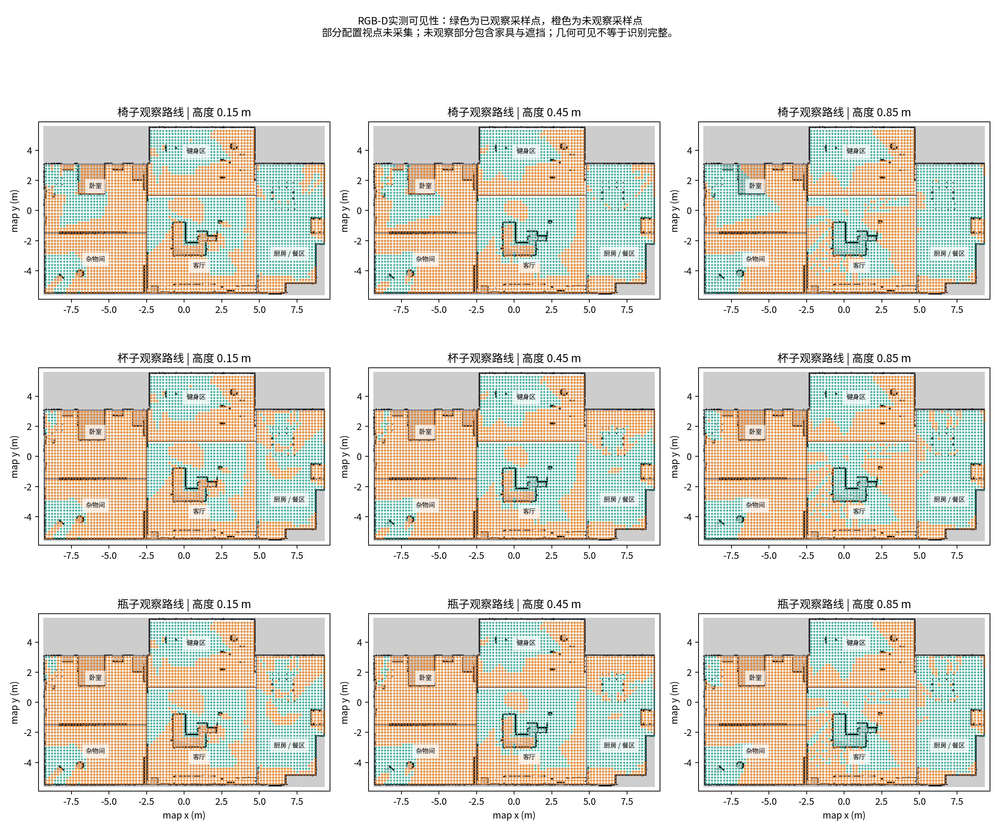
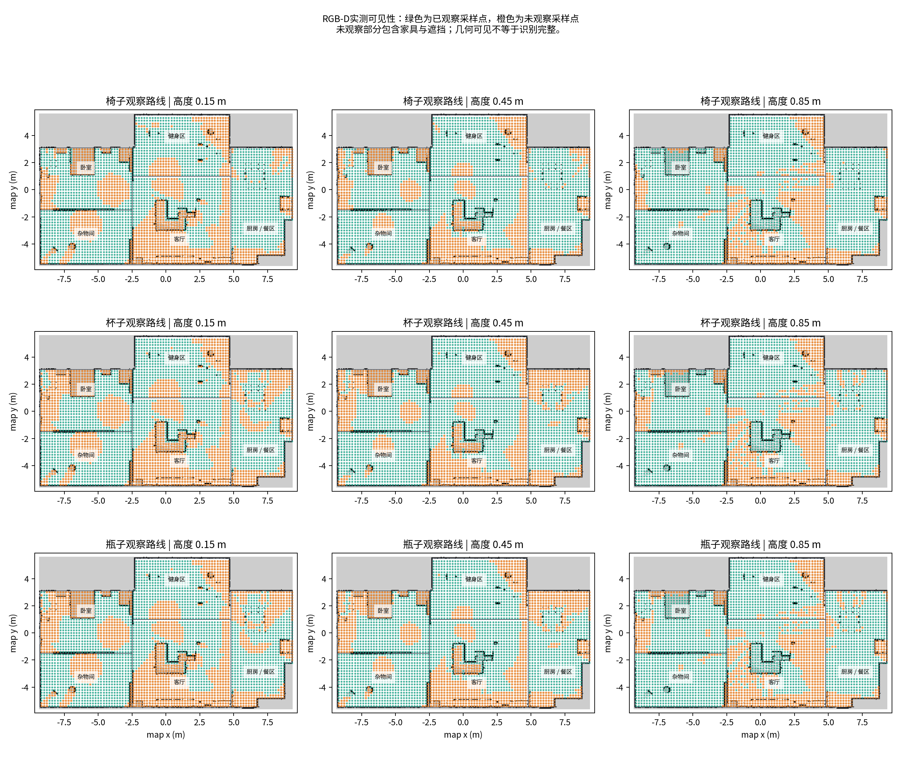

# 当前验证概览

本轮恢复项目开发与验证，暂停PPT制作。最新四项状态如下；下方旧轮次保留其冻结配置和失败范围。

| 本轮任务 | 实际结果与证据 |
|---|---|
| 三球局部补扫 | 首轮补扫净增274格/160.71秒，整体80.69%/20of27仍partial，独立停靠16.43cm失败；be7复测补扫新增696格/180.07秒，总80.21%/15of23仍partial，独立停靠16.08cm仍失败；后续建图未派发。[首轮原审计](../../results/development/demo_two_rooms_20261123/cleaning_followup/ball_trial/local_replan/utility/audit.json) |
| 新增客厅香蕉 | 所选双香蕉布局find1/count2首次通过，XY最大14.76cm，完整两方向计数/原生源/接触/地图回充通过；未当多布局稳定准入。[首轮审计](../../results/development/demo_two_rooms_20261123/living_banana/audit.json) |
| 语义核验与收益 | 同一香蕉移60cm后find1/count1、XY10.31/8.03cm，旧位置待核验/新位置现场更新，SQLite/API与真实Spark-DSG重载一致、独立回充通过。[变化核验](../../results/development/demo_two_rooms_20261123/semantic_followup/living_banana/heading_fix_audit.json)。新增安全点ABBA四次正确性过，但两组分别慢18.56/24.90秒、约多走2.8m，新增点均0投影；[收益失败](../../results/development/demo_two_rooms_20261123/semantic_followup/living_banana/abba2_audit.json)保留，已隔离为默认关闭实验。不能称“记忆更快且同样准确”已过 |
| 局部行进建图 | 平移2.147m/转弯6.549rad/重访差9.02cm，保存及独立map_server重载栅格完全一致/原地图哈希保持/恢复导航通过；独立停靠18.03cm使整项failed，修复返航复测在后续串行队列。[原审计](../../results/development/demo_two_rooms_20261123/mapping_loop/trial/audit.json) |

工程最新完整536通过/38条件跳过18.90秒、三包2.03秒构建通过；只表示工程检查，功能以各原审计为准。新增点初版ROS参数别名启动失败、UI终态单次不新鲜、验证器DDS里程计发现等待不足及初版精确停靠朝向停滞失败均保留；修复版默认关闭新增点、原记忆排序保留，原覆盖/数量/.20m/独立停靠门槛不改。

以下为此前阶段记录（当前运行状态见HANDOFF）：

当前新增共享点云候选：独立原云/深度同戳校准及锁定签名、实际Lazy停流通过，默认native保留；三帧实测几何差约1微米、原云29.5MB/帧与深度4.9MB/帧，1280保持stride8/160×120采样。真实箱体标障清除0→100→0、模型恢复、静态19760次检查0超界；新候选两次find/返航全窗134235检查0超界、cloud最大gap.186秒。此为源连续性和相关标障/清除子项，不是所有避障/稳定验收。[收据](../../results/development/cloud_continuity_20261122/depth_image_candidate_20261124/audit.json)。

语义对照仍未通过：驻留修复后的原云4任务正确但源169超界；image候选首无记忆XY .1178m过，有记忆.2528m失败即停。每任务32帧点完全稳定，真实TF诊断把map跨任务差13.71cm精确解释为定位变换差；反算odom差.053mm，仅作诊断，不替代map结果。AMCL后验仍宽，当前未改其参数/初始置信度；只读核查后按用户安排暂缓追加优化，继续第5项预检与交付，不重复碰运气。[实际定位审计](../../results/development/cloud_continuity_20261122/depth_image_candidate_20261124/memory_abba/position_frame_audit.json) · [实际坐标差异图](../../results/development/cloud_continuity_20261122/depth_image_candidate_20261124/memory_abba/position_frames.png)。最新工程513通过/38跳过21.09秒、三包2.73秒，首次原生加载审计QoS错误和单测误改Inf的失败日志保留。

## 答辩素材入口

最新交付：[13页可编辑答辩PPT](../../results/development/demo_two_rooms_20261123/delivery_preflight/defense_deck_styled/defense_presentation.pptx) · [PDF](../../results/development/demo_two_rooms_20261123/delivery_preflight/defense_deck_styled/defense_presentation.pdf) · [完整ZIP](../../results/development/demo_two_rooms_20261123/delivery_preflight/defense_deck.zip)。已串联统一架构、四基础任务、两区清扫/北侧绕行/现场计数、语义变化核验、7类空间图/关系图和共享深度输入，原生325段可编辑文字、原图嵌入；真实Office重新打开导出、13页总览及修正页核对通过，522项ZIP文件SHA全部通过。两原始4倍UI视频另附，未嵌入PPT，不作相机或完整任务视频；团队信息/真人验收仍待补，未最终提交。原8页素材包保留。[演示稿审计](../../results/development/demo_two_rooms_20261123/delivery_preflight/defense_deck_styled/audit.json) · [打包收据](../../results/development/demo_two_rooms_20261123/delivery_preflight/defense_deck_archive_audit.json)。

合成计数有界复核已完整结束：[原审计](../../results/development/demo_two_rooms_20261123/delivery_preflight/synth_voice_count_followup/audit.json)。同343f根393.90秒、18/18方向完整驻留/观测，却只确认2/评估4，数量未过；匹配的两把XY .08357/.04770m在既有.30m内，整项position=false含完整匹配缺失，不误称两把均定位超限。地图回充完成、独立仿真停靠.155946m>.15仍失败；停稳.96秒/接触0/心跳、207899次源检查0、实际UI终态/浏览器清理过。strace与处理器本轮未收到停止信号；旧中断仍未定因，不称修复。数量缺项不能再归于本轮中断，不继续重跑或调参；真人与完整整机验收保持未完成。

2026-11-24当前配方合成语音预检：Firefox原生MediaRecorder→离线ASR→原文UI确认→真实任务链路已实际执行，未使用真人麦克风。找杯转写“请去厨房找一个杯子。”，现场1杯、两处必巡/3of11、保存和独立回充通过，但XY .244603m>.20，整例failed；完整76405次源检查0超界、接触0/心跳/浏览器清理过。椅子计数转写正确，但验证进程在6/18方向后收到未记录来源的停止信号，脚本取消、原任务canceled；部分1把不作总数，79591次源检查0不代表完成计数。中断后公共地图回充误差7.97cm、模拟充电完成；独立仿真误差16.46cm超过15cm，故恢复返航审计仍failed，21898源检查0/接触0/停稳.8秒通过，当前ready/idle。原验证脚本的浏览器上下文/未绑定fetch错误也保留；只修验证器，未改机器人参数或放宽门槛。[找杯原审计](../../results/development/demo_two_rooms_20261123/delivery_preflight/synth_voice_bound_fetch/audit.json) · [计数中断审计](../../results/development/demo_two_rooms_20261123/delivery_preflight/synth_voice_count/audit.json) · [完整预检汇总](../../results/development/demo_two_rooms_20261123/delivery_preflight/system_precheck.json)。

2026-11-24后续：同856d470e显式image/S1280/v14/书球辅助/记忆候选，四项日常代表任务已完成独立复核。[本轮矩阵](../../results/development/demo_two_rooms_20261123/delivery_preflight/daily_regression/combined_audit.json)：静置箱原生检出/实际接近/绕行后杂物间10点正确报告0杯并回充；移动项实际已发布路径上横穿、原生占据变化、0.34秒提前近停、续行/寻找1杯XY .11593m/回充；普通门口实际经过、两处巡视/杯XY .08743m/回充；持续堵路实际改走替代通道、原10点/0杯/回充。接触夹具落球校准、机身/夹具无接触记录、观察器心跳和模型清理均核对。不是一次连续四任务或所有配置安全认证。

移动项原首例只在观察点停车，仍拒绝作为让行；相关复测原1.5m筛选又漏计提前停车。新`audit_moving_yield.py`保留.05m/s/.2s/.45s，改按新鲜真实已发布路径、原生0→占据变化、排除观察目标及入口到点停车核对，不要求机器人靠近障碍才算成功。冻结真实正反例、缺占据/缺实际路径及过期旁证5项回归通过。有效停让.34秒、名义穿越点距1.669m，另.74秒近停缺少足够新鲜的占据快照旁证，不额外计入；原所有failed不覆盖。同目标原生重规划在有效停车前已改变，旧路径对当时夹具距离0、新路径名义表面余量.2787m，见[原生响应旁证](../../results/development/demo_two_rooms_20261123/delivery_preflight/daily_regression/related_followup/moving/native_response_audit.json)。这是验收统计修复，未改机器人参数、位置或真值。

时效范围：静置/移动两完整观察窗146164/76919检查均0超界；普通门口自身完整窗53391检查0。门口＋堵路的合并观察器原failed7次，均静止夹具准备期：保留原failed，按既有回调时钟包围法对堵路完整任务首末各扩.5秒，102119检查超界0。仅代表任务窗通过，**全运行时稳定性仍未通过**；不删除准备期失败或放宽.4/-.1门槛。堵路原生odom跨阻挡面y=-.590/-.594，确经替代通道，未声称全封门停车。热态SLAM本轮复核33532检查0超界、完整短转/停止/另存/恢复/回充过；180秒旁路观察无断流，旧热根原因未定、未改QoS。[切换复核](../../results/development/demo_two_rooms_20261123/delivery_preflight/transition_diagnosis/audit.json)。

已按老师原四章模板生成[可编辑报告草稿](../../results/development/demo_two_rooms_20261123/delivery_preflight/report_draft/project_report_draft.docx)和[PDF](../../results/development/demo_two_rooms_20261123/delivery_preflight/report_draft/project_report_draft.pdf)，10页A4、真实图与各自结果范围、上游来源、当前配置/源码及审计散列；实际LibreOffice打开/导出与PDF文本检查通过，封面排版已查看。姓名/学号/实际分工待填，真人麦克风未测，未作最终提交。[生成审计](../../results/development/demo_two_rooms_20261123/delivery_preflight/report_draft/audit.json)。本轮未改ROS产品源码，无新构建；新增验收器5项通过，不冒充重跑前轮513/38。

2026-11-24交付阶段：用户暂缓定位/语义对照追加优化，未改AMCL或门槛，转计划第5项。[离线素材包](../../results/development/demo_two_rooms_20261123/delivery_materials/index.html)含8张16:9 PNG、原图/两段真实UI视频、审计和5会话冻结配置/源码，430文件SHA核对；搬移ZIP后实际Firefox8页/500px通过、2270和1186帧视频完整解码、临时浏览器0退出/清理通过，机器人任务不变。[素材审计](../../results/development/demo_two_rooms_20261123/delivery_preflight/materials_browser/audit.json)。来源均为下表原记录，不称新增整机验收，三球partial附录和语义收益未通过明确保留。初打包同名文件被散列守卫拒绝、浏览工具Snap/tmp和缺ffprobe错误均保留，分别改保留相对目录、工作区隔离profile和已有PyAV后通过；没有更改产品或验收门槛。

同当前cbd3ce16/image/v14/S1280/书球辅助/显式记忆根，连续文字“去卧室找一本书”“统计卧室有多少本书”实跑通过：find1、121.15秒、XY .110617m；完整count2/2、158.78秒、XY .100276/.042690m，两必巡/保存/现场记忆/回充/接触0通过，各完整观察窗60636/79999次检查源超界0。不是冷启动重复、真人麦克风或四功能全部验收。普通杂物间本次回归8502/9336=91.0668%、26of27、659.18秒预算结束partial：lane19九格实刷八格、缺一格；冻结刷盘/停车/回充(.09443m/.09621rad/.46秒)/336428次源检查0超界通过。额外接触观察线程ExternalShutdownException导致完整性未证，上层审计保持not_accepted，不用空列表冒充全窗无接触，原异常/原审计保留。[清扫本轮限制与子项](../../results/development/demo_two_rooms_20261123/delivery_preflight/cleaning/audit.json)。不再重跑或调参。热态切建图出现clock/odom/scan断流（独立5秒0帧、RGB11帧），150秒验证超时且180秒整栈保护关闭/残留[]；[原失败](../../results/development/demo_two_rooms_20261123/delivery_preflight/mapping/audit.json)保留。随后同配方冷根856d470e仅一次检查通过：实际短转.79573rad/停止/SLAM另存YAML+PGM/恢复原主图/回充(.06819m/.09136rad/.46秒)，原主图散列未变，接触观察心跳完整/记录接触0、34155次源检查0超界；[冷启动子项](../../results/development/demo_two_rooms_20261123/delivery_preflight/mapping_cold/audit.json)。独立90秒无断流，未触发GDB；不当热态修复或新全屋地图验收，整机仍待通过。[本轮汇总](../../results/development/demo_two_rooms_20261123/delivery_preflight/system_precheck.json)。[当前预检](../../results/development/demo_two_rooms_20261123/delivery_preflight/audit.json)。本轮仅新增打包/验证工具与文档，py_compile/diff通过；前轮513/38及三包构建不冒充本轮重跑。

同8张真实PNG另生成[16:9素材PPT](../../results/development/demo_two_rooms_20261123/delivery_preflight/presentation_materials.pptx)及[PDF](../../results/development/demo_two_rooms_20261123/delivery_preflight/presentation_materials.pdf)，实际LibreOffice重新打开/导出8页、栅格预览已查看。首次ODF母版标签错误、随后Office单位取整导致严格比例校验失败，均保留；最终标准化页面及全页图片到12192000×6858000 EMU后原比例门槛通过，PNG内容未改。[导出审计](../../results/development/demo_two_rooms_20261123/delivery_preflight/presentation_audit.json)。这是图片素材页，非最终论文答辩稿或可编辑图表。

以下均指向已有真实记录；不同会话的素材分开展示，不拼称一次连续验收。

| 可展示内容 | 素材与审计 | 表述范围 |
|---|---|---|
| 卧室均匀清扫与回充 | [实际覆盖/轨迹图](../../results/development/demo_two_rooms_20261123/cleaning_followup/repair/bedroom/presentation.png) · [审计](../../results/development/demo_two_rooms_20261123/cleaning_followup/repair/bedroom/audit.json) | 单次84.85%、19/19，接触/时效/回充通过 |
| 杂物间完整清扫与补扫 | [实际覆盖/轨迹图](../../results/development/demo_two_rooms_20261123/cleaning_followup/repair/utility/presentation.png) · [局部补扫对照](../../results/development/demo_two_rooms_20261123/cleaning_followup/repair/offset_actual.png) · [审计](../../results/development/demo_two_rooms_20261123/cleaning_followup/repair/utility/audit.json) | 无新增球单次92.74%、26/26；原漏格由实际刷盘补齐 |
| 途中箱阻挡后自主北侧绕行、厨房任务与回充 | [两条实际路线](../../results/development/demo_two_rooms_20261123/route_pair/actual_pair.png) · [配对收据](../../results/development/demo_two_rooms_20261123/route_pair/audit.json) | 无强制北侧航点；夹具准备期源超界和首次无箱失败另留 |
| 两房间两处支撑面的碗/书寻找计数 | [案例/配置/失败总收据](../../results/development/demo_two_rooms_20261123/bowl_book/audit.json) | 显式S1280/书辅助/v14所选布局首轮通过，额外布局/重复暂缓 |
| 物品变化后的现场查找与记忆更新 | [真实前后记录图](../../results/development/demo_two_rooms_20261123/semantic_followup/movement_cup_diagnostic/memory_change.png) · [4倍UI片段](../../results/development/demo_two_rooms_20261123/semantic_followup/recording_cup_diagnostic/ui_telemetry_4x.mp4) · [审计](../../results/development/demo_two_rooms_20261123/semantic_followup/movement_cup_diagnostic/audit.json) | 单次位置变化核验/现场计数；不称物理身份重识别或合格提速收益 |
| 同底图7类空间视图＋真实语义关系图 | [八图总览](../../results/development/demo_two_rooms_20261123/map_exports/shared_views_verified/gallery.png) · [原图/原始JSON](../../results/development/demo_two_rooms_20261123/map_exports/shared_views_verified/audit.json) | 每图保留会话/图例/源戳，代价图为原生全局图 |

三球补扫本轮仍未通过完整清扫：79.68%/16of25/645.79秒，接触0/时效0/回充/原刷盘重画及停稳通过。新分支3次实刷111/121/1格，末次失败/恢复预算不足后返航；末次观测规划掩膜潜力内1070格未扫、外827格，仅供诊断。布局/rooms/nav逐字相同，但冷启原始条带25/旧28，本轮额外启球辅助，不能作严格同负载提速。原79.50%及所有失败保留，本轮不继续加测。

[三球本轮收据](../../results/development/demo_two_rooms_20261123/cleaning_followup/ball_trial/repair_followup/audit.json) · [漏扫诊断图](../../results/development/demo_two_rooms_20261123/cleaning_followup/ball_trial/repair_followup/remaining_snapshot.png) · [真实UI片段4倍/142秒](../../results/development/demo_two_rooms_20261123/cleaning_followup/ball_trial/repair_followup/recording/ui_telemetry_4x.mp4)。片段开始于任务中途，非全任务/相机视频，终态partial明确保留。完整工程501通过/38跳过12.23秒、三包1.12秒；首次全量误收集历史测试副本的日志保留，限定tests后通过。

新清扫实际HTTP导出另项通过：[导出审计](../../results/development/demo_two_rooms_20261123/cleaning_followup/ball_trial/repair_followup/exports/audit.json)。clean_trace/clean_coverage各PNG/SVG/JSON与原result/plan/全trace/eligible/covered完全一致、无动作，不把导出通过等同清扫通过。厨房v15压缩观察路线仍候选、暂缓继续优化，原第5轮及诊断1/2失败保留；答辩沿用各已通过素材的原配置；后续记忆阶段结果及当前交付状态见本页顶部。

统一导图新增7类空间视图及真实Spark-DSG关系PNG/SVG/原始JSON，保留同一逻辑底图。实数据8图的底图几何/占据SHA一致，来源会话与状态分别标注；观察只画有效实测到达/方向，清扫使用完整实测轨迹及冻结刷盘，核对原floor/eligible/covered，非目标房间不着色，定位断点不连线。关系图逐项核对真实家庭—房间/房间—物品边与修订。实际浏览器5种即时视图三文件下载/500px通过；清扫导出为真实旧源离线＋隔离HTTP验证，不称本轮新清扫。初版错误着色图及断点测试误计图例的失败日志保留，修复后完整498通过/38跳过20.00秒、三包2.40秒。统一[导图收据](../../results/development/demo_two_rooms_20261123/map_exports/audit.json)与[8视图总览](../../results/development/demo_two_rooms_20261123/map_exports/shared_views_verified/gallery.png)。

另用原Piper合成音频实际预检：正确转写“请去厨房找一个杯子。”，同公共任务执行，find1/两处必巡/3of11/132.49秒含回充、接触0/过期0/回充通过，观察HTTP导出与原diagnostics完全一致；但独立XY .206539m>.20，整体预检failed，原客户端passed不等于位置验收通过。音频临时文件已删；不是真人麦克风验收。这个冷启定位波动仍待修复，不与上一轮厨房变化核验通过拼接成稳定性。[预检失败](../../results/development/demo_two_rooms_20261123/map_exports/task_export/audit.json)。

后续配对路线：同1bd0ec80根，原无箱计数2/2、XY≤.07672m、11/11/回充通过，但独立源时效49次超界集中.194秒，原failed保留；仅一次同配置baseline_retry再完整通过、时效0。随后箱在已发布客厅路径(1.09879,-3.74713)中途加入，真实检出后自主走家具北侧，原固定点不变、两杯定位最大.13874m/11点/两处/无接触/回充(.07882m/.09918rad/.46秒)通过。两份实际首段轨迹在箱横截面中位y=-3.75575→.00722m，符合靠近健身区的北侧，无需进入gym。[实走对照图](../../results/development/demo_two_rooms_20261123/route_pair/actual_pair.png)。

放箱原全观察窗审计仍failed（5次）：发生在源sim1768.794–1768.804的静止夹具准备期，早于正式任务首样1771.46；harness本就先等停稳和fresh再发任务。新task_window_audit保留全部原错误，用每个bad check前后callback时钟包围，并将首末任务采样各外扩.5秒，完整任务132937检查/超界0，门槛仍.4/-.1，其他原门槛均通过；scope定义与局限公开，不删除旧failed。临时模型/桥接恢复，数量从现场来。线程膨胀假设导入探针未支持（两种均1线程），没有为此修改产品参数。不是所有运行稳定性通过，首次无箱真实任务时效风险仍待有界处理。[配对及范围审计](../../results/development/demo_two_rooms_20261123/route_pair/audit.json)

三新增球清扫已收尾：79.4987%、19/28、673.95秒、budget结束partial，回充/停稳/接触0/过期0/冻结刷盘重算通过。三球原无球条带均相交，native占据均见、底盘原生odom最近中心距.579/.588/.643m，检出后新刷5491格；仅避障/继续/返航子项通过，可达残余清扫未完成，不能把1914未扫格全部归球。原生mask刷盘潜力上界94.72%不当实扫。45秒球检测同步抓帧超时，未当语义类别验收。[子项审计](../../results/development/demo_two_rooms_20261123/cleaning_followup/ball_trial/audit.json)

语义后续候选：最多1个现有近点历史方位朝向，必巡/全回退保留，find显式启用、计数不变。全480通过/38跳过19.14秒、三包2.48秒；验收器随后修正find早停已访列表与完整计划的区别，真实夹具回归通过。Gym单次无/有记忆find均1且XY .13497/.17588m，搜索122.60→71.13秒/少.80464m，但未交叉顺序，新增朝向0有效投影；baseline7次任务内源时效超界，不能说完整收益验收通过。[收益及限制](../../results/development/demo_two_rooms_20261123/semantic_followup/benefit_audit.json)。移动Gym球后find正确，完整count2/真实1失败，成因未确定，原球已恢复；[失败收据](../../results/development/demo_two_rooms_20261123/semantic_followup/movement/audit.json)。转已声明厨房单杯移动核验，不长期停留球类。厨房首轮find1、两处巡视/无接触/回充/62768次时效0超界，但XY .31338m>.20，独立判failed，未派发count、杯已恢复；原客户端passed仅代表其导航/数量子项，不等于独立位置通过。随后只做一次同配置同步RGB-D/TF诊断复测，不改参数或门槛，结果另存movement_cup_diagnostic。

厨房变化核验同配置唯一诊断复测通过：find1/XY .11687m/133.62秒含回充，count2/2、XY .17744/.09113m、11/11/227.75秒、两处必巡/接触0/源超界0/回充通过。旧位置待核验、新位置由现场更新；独立SQLite/API与真实Spark-DSG重载52节点51边/46历史记录全部字段一致，显式移动变体冷加载后记录/修订/图一致。厨房必巡前缀未变，不当提速对照；未确认物理身份，未证明旧位绝对空。同步几何说明复测count首点map误差.242m、odom约.039m，互补观察后结果.177m；首轮缺同戳TF，唯一根因未定。最新工程481通过/38跳过17.49秒，构建沿用产品前次三包2.48秒；后验分析首次导入路径错误修正，不改机器人结果。[变化核验](../../results/development/demo_two_rooms_20261123/semantic_followup/movement_cup_diagnostic/audit.json) · [真实记录前后图](../../results/development/demo_two_rooms_20261123/semantic_followup/movement_cup_diagnostic/memory_change.png) · [74秒4倍UI遥测片段](../../results/development/demo_two_rooms_20261123/semantic_followup/recording_cup_diagnostic/ui_telemetry_4x.mp4)。片段由原WebM297.134秒/1186帧加速、无插帧，非Gazebo相机视频，首次失败另留。

本轮两区清扫修复：旧e5899ede杂物间90.23%/25of26后返航实际碰FoldingDoor_01_002，564事件，独立观察器取消/停稳、未回充，原失败保留。仅将默认local/behavior坐标改为odom并关闭local静态层，保留global map/.25半径/原速度/NavFn+DWB；另新增安全侧向短段补扫，预测不计实际覆盖。新冷根b1c2928b同书碗S1280配方连续完成：杂物间8658/9336=92.7378%、26/26、629.44秒；卧室6767/7975=84.8527%、19/19、511.33秒。两区均原分母/冻结刷盘重画一致、真实接触0/过期检查0、动作停稳和回充通过。offset实用4次、原4漏格补齐，[局部对照图](../../results/development/demo_two_rooms_20261123/cleaning_followup/repair/offset_actual.png)。部分原生Follow失败保留；单次两区通过不当作四项日常避障全回归。观察子进程均0且无残留；驱动保存两审计后返回143，未宣称编排退出0。旧新根均正常收尾。三静置球场景转单独测试。[本轮收据](../../results/development/demo_two_rooms_20261123/cleaning_followup/audit.json)

地图快照：新增map_export.py、只读派生POST /api/map/export与UI按钮，输出带图例/时间/源/会话/有效规划与实测清扫采样轨迹的PNG/SVG和完整原始JSON。两区真实数据直接导出通过；新冷根1bd0ec80实际Firefox按钮与PNG/SVG/JSON三文件下载及500px无溢出通过，隔离profile/进程已清理。只接受同map新鲜原生全局代价，不接局部odom图；各源戳分别保存，不声称严格同步。全量476通过/38条件跳过20.49秒，最终相关74通过、JS语法及三包构建2.82秒通过；首次未加载ROS的收集错误及Pillow兼容修正保留。原生源码未改，本轮未重跑原生专项。[快照收据](../../results/development/demo_two_rooms_20261123/map_exports/audit.json)

2026-11-23新增碗书实跑：原9杯瓶保留，新布局在厨房两处各1碗、卧室两处各1书，资产哈希/目标AABB无重叠及支撑高度检查通过。S1280＋仅book辅助-v13的新增4项找/数通过，随后原卧室杯count3/2，RGB-D定位到原垃圾桶误识；n640＋book辅助-v13原杯4项通过，但碗/书count均1/2失败。没有改分数、尺寸或关联门限。最终v14保留必巡及原近处互补点、去掉卧室杯/书两个远距离补充点（6→4目标），同S配方8项寻找/计数＋两房原杯回归全部通过，所有计数2/2；碗count最大XY.07016m、书count最大.11648m，全8项最大.18721m≤.20，必巡、到点、保存、记忆和回充均通过。原始各配置报告与失败不改，紧凑路线仅验证所选支撑面布局，垃圾桶分类本身未通用修复。

两新类别保持显式候选，正式3变化布局/5重复未完成。45秒当前配方源时效抽查20170次过期0；UI语义/关系图及独立真实Spark-DSG重载46节点45边/40条历史记录与API逐字段一致。该阶段根4e904695结束时已回充就绪空闲（后续已关闭，当前运行见交接），观察器和隔离浏览器清理；未新增依赖或修改产品算法，配置校验/py_compile/diff检查通过，未重跑全量工程或原生测试。唯一[本轮收据](../../results/development/demo_two_rooms_20261123/bowl_book/audit.json)，实际图像/深度、模型配方、原失败及UI截图集中同目录。

2026-11-23厨房计数首阶段：旧892根仿真已正常退出、控制台未就绪，正常关闭所属栈；新cc4根两次默认完整计数分别2/2通过、3/2失败。新增只读observe.py保存同戳检测/深度/CameraInfo和map/odom/optical TF、各视点RGB-D；失败额外实例对应灶台旋钮、33帧、extent最大.02713m，不是本轮餐桌分裂。首轮餐桌跨视点map差约.132m而odom约.023m，支持定位修正关联风险，但历史失败没有同步TF，未证明其唯一根因。depth.py杯校验增加4cm最大片段下限，冻结回放失败3→2、正常2→2，观察到的真实杯均保留；较小/遮挡杯可能拒绝，需补足视点。合并半径/命中/score/导航/路线未改。

构建后b027根所选厨房杯完整案例5次（首轮冷启）全部2/2、11/11和两处必巡、定位最大.16562m≤.20、结果/记忆保存/回充/停车/无接触记录/独立传感时效通过；5轮尺寸拒绝均0，不能当作误识同条件修复或历史分裂闭环。465项通过/38条件跳过、三包构建通过；首次全量测试缺scripts导入路径的收集错误保留后修正。未重新跑原生测试（原生源码未改）。新观察器已退出、未创建临时模型，系统保持就绪空闲。唯一[本轮审计](../../results/development/demo_two_rooms_20261123/count_diagnosis/audit.json)，同步数据/原失败/冻结回放/诊断图集中同目录。两房路线优化、历史坐标分裂、扩展类别和后续清扫/语义尚未完成。

2026-11-23最新：展示选择卧室/杂物间，默认配置四项代表避障与清理后关键路线已实跑通过，卧室清扫单次通过、杂物间仍partial；UI避障观察已接入，见下节。

2026-11-22此前调整：清扫80%并核对全部可达规划条带的实扫，重点卧室/健身区；碗/苹果、书、两房球按3布局与选定案例5重复含冷启动继续开发验收，语义重点历史引导查找和移动更新。真人麦克风可继续联调；历史85%记录保留。以下较早阶段数字不代表当前配置成绩，以本页新增阶段与HANDOFF为准。

本页维护主要结论和证据入口，完整过程放入 [历史开发记录](../archive/validation/DEVELOPMENT_VALIDATION_20261117.md)。当前执行顺序见 [总计划](DEPLOYMENT_PLAN.md)，运行命令见 [RUNNING.md](RUNNING.md)。

## 11月23日恢复：旧占据清除与连续通行通过，重复计数仍失败

原生射线重放排除“仅增大量程即可”的结论；实际raw与depth各62476正Inf逐像素一致、NaN/零/负Inf均0，Fortress像素中心+.5对有限XYZ误差中位1.72e-7m。适配器新增仅清除流：有限点＋经新鲜内参/几何验证的正Inf量程端点；只在仿真传感器clip/far=8m标定下启用，未知/坏深度不当作空闲。默认原标障仍有限点/.08–1.1m/2.5m，独立清除范围4m、原生体素裁剪、源时效.4秒；控制/半径与静态未知规则未变。

892635c1同一会话：箱阻完整计数杯2/2、11/11固定点/餐桌与操作台、XY误差.02872/.04198m、回充通过；物理箱清理后原点cost85→0→0。下一次任务实际经过旧箱通道（最小map中心距.02249m、原生计划.02161m），11/11与回充/无记录接触/数据新鲜通过，未重启或清图。但该次杯计数3/实际2：餐桌视点0与3形成相距.312m的两条记录，计数failed保留；不能据避障修复宣称连续计数稳定。再做一次相关移动箱回归通过，低速2.12秒后继续并回充，夹具均清理。[修复收据](../../results/development/demo_two_rooms_20261123/clearing/audit.json) · [连续实际路线与清除图](../../results/development/demo_two_rooms_20261123/clearing/no_return/repair_summary.png)。

工程464通过/38跳过、原生3项通过、构建通过。UI实际24次绘制0缺层、隔离HTTP断流正确标过期并恢复，4位置/11目标及巡视朝向进度同步通过。当前保持默认修复根就绪供查看；仅实际重观测的自由空间清除，遮挡/视距外不按时间丢弃。下一步有界诊断餐桌杯重复记录，不放宽.30关联门限/.20定位验收。下节为暂停时历史过程。

## 11月23日：旧占据清除修复与UI代价图（用户已暂停，未整链路通过）

独立地面清除源修复后，同一根2次静止箱体0→100→0通过；旧基线为0→100→100。原生3测试、工程461通过/38跳过，NavFn/DWB/半径及标障高度不变。但完整餐区计数/回充后的箱清理仍残留99达45秒，第二次计数按门槛未派发；静止局部通过不能升级为完整修复。保留真实点云、清除端点、lethal格和TF位置，后续需核对距离/射线离散及历史map投影，不清图强过。

UI全局代价叠加、4秒显示缓存/明确过期保留及预设点显示修正已验证：24实际绘制0缺层、隔离浏览器HTTP断流过期与恢复通过，厨房杯4位置/11目标包含必巡点；实际v6的8朝向路线未改。用户明确暂停后4c3d6e03正常关闭/无所属残留，8767释放；当前代码保留部分修复，不能认定稳定展示已验收。[暂停收据](../../results/development/demo_two_rooms_20261123/clearing/audit.json)，恢复入口以HANDOFF为准。

## 11月23日追加：客厅途中箱阻挡→餐区完整计数→回充

沿用同默认n640/v6/service_surfaces_v2/NavFn+DWB，原根1a9f7587提交kitchen/cup/count。机器人行进时在已发布的客厅路径上实际放入.5×.5×.8m箱，约2.351m前方；箱保持至任务完成。原生global检测该路径点约1.119秒后由40→99，机器人最近中心距箱中心1.529m并改走旁侧通道，仍按原固定点巡视餐桌及灶台拐角操作台。11/11目标到达并完成观察，计数2/实际2，唯一匹配XY误差.06393/.06067m，编号/现场计数及回充(.12245m/.09571rad/.46s)通过，总265.86秒。接触源落球校准、机身/箱体接触记录0，独立137775次新鲜度检查过期0，观察器退出0。无产品参数变更，验证工具语法通过，原16类稳定准入/清扫结论不提升。[独立审计](../../results/development/demo_two_rooms_20261123/living_kitchen_count_01/audit.json) · [实际路线](../../results/development/demo_two_rooms_20261123/living_kitchen_count_01/actual_route.png) · [完成页面](../../results/development/demo_two_rooms_20261123/living_kitchen_count_01/ui_final/obstacle_ui_desktop.png)。

收尾另发现：物理夹具移除后原生global旧点仍99；新自由观测是否覆盖、各层raytrace结果未核实，不称作自动清除通过，不用真值清图。保留post_cleanup_cost.json，旧根正常关闭/无所属残留；同默认冷恢复131a176e就绪空闲，原点连续两次cost0（restoration.json）。冷恢复只恢复测试环境，未修复/验收自动清除。后续有界诊断该占据保留；原两区清扫问题及既定任务次序保留，当前运行状态见HANDOFF。

## 11月23日：卧室/杂物间展示复测与UI避障观察

按用户最新安排选择卧室、杂物间，健身区/Smac暂缓。两次根都使用默认n640/v6/service_surfaces_v2/NavFn+DWB，无body/安全候选/辅助模型/记忆引导；第二次根仅加入只读避障遥测和UI，不改控制参数。统一[收据](../../results/development/demo_two_rooms_20261123/audit.json)。

| 实跑 | 本轮结果 | 判定 |
|---|---|---|
| 卧室完整清扫 | 6843/7975=85.81%，18/18原条带，603.94秒，回充通过 | 本轮单次通过 |
| 杂物间完整清扫 | 8410/9336=90.08%，25/26原条带，657.03秒，预算结束、回充通过 | 部分完成：短条带4格未刷，末次live cost均99 |
| 家具绕行、普通门口 | 杂物间受家具阻挡的直线由实际绕行完成；两区进出门及回充有实轨迹 | 代表用例通过 |
| 移动物体 | 卧室临时箱横穿时实际减速，连续低速1.76秒，移开后继续查找并回充 | 代表用例通过 |
| 持续堵路 | 杂物间门口箱持续存在，原生地图标障，机器人经替代通道完成10/10巡视与回充 | 代表用例通过，未宣称完全封门停车 |
| 清理后关键路线 | 卧室找1杯、书桌/床头柜必巡与回充通过 | 回归通过 |

清扫冻结源码独立重画与原分母/原条带完全一致，动作顺序和停车通过；独立观察接触记录0/数据过期0，观察器清理退出0。临时箱接触源经落球校准，所有临时模型和桥接已移除；没有清图、改真值或缩分母。世界停靠精度和轮/地面接触不由这些证据保证。详细分别见同目录utility/bedroom/audit.json、routes_audit.json、encounters_audit.json和key_route/report.json。

用户随后提出更醒目的呈现：UI改为大标题/距离与速度卡片、近障整卡橙黄、直接可见最近事件。仅静态UI热更新；实际桌面/500px及JS语法验证通过，近障颜色为CSS呈现检查，不新增机器人验收。改后HTTP实发SHA、报告和截图在同一收据ui.emphasis_followup与ui_emphasis/，原根启动冻结UI副本保留。

UI新增实时激光障碍点、近障距离/方位、实测速度、原生规划路径和最近事件；终端打印障碍观察。激光/odom有效期.4秒、路径2.5秒；.70m仅为中心距离显示阈值，不控制速度，不把激光呈现当作全部深度障碍，也不将“正在运动”自动判成避障成功。实际Firefox桌面/500px宽验证通过，近障[实测截图](../../results/development/demo_two_rooms_20261123/obstacle_ui_near_live.png)。新增3项过期/无效激光/倒车方向回归，相关109项通过、全量460通过/38条件跳过13.29秒，JS语法通过。根b8465695正常关闭；当前1a9f7587在8767就绪空闲供查看，实时状态以HANDOFF为准。下一步有界处理杂物间短条带漏扫，不扩大导航算法比较。

## C041：80%与空间覆盖、扩充校准及语义呈现（2026-11-22，继续开发）

**11月23日当前结论（下方为历史过程）：** 健身区仍未验收。最新显式body/原生NavFn格心与odom障碍记忆/小缺口和掉头内收候选，5e0c102d完整gym_turn_room_01为56.615%/8/23、612.03秒；90.417秒无新增覆盖且净移<.10m，验证器取消，停稳但未返航，原canceled保留。接触记录/过期检查0，四观察器退出0，根已正常shutdown无残留。此前同Native配置的南口、后方.5m实刷175格、北侧接近后双椅5+8及map返航局部通过，不能代替整房。3056完整4.53%/0/23/返航通过亦保留。末态原生深度列重放使完整padding.03轮廓得254，真实接触0，支持当前安全轮廓阻塞；不证明唯一规划器根因，不擦格/缩padding。457通过/38条件跳过、原生2/停车27，三包1.56秒。Smac Lattice单项候选配置与fresh-context审查已准备但未授权/未启动，总计划NavFn不改、P5未开始。证据统一[本轮修整收据](../../results/development/gym_completion_20261122/footprint_trial/audit.json)及[实际覆盖图](../../results/development/gym_completion_20261122/footprint_trial/turn_full/actual_coverage.png)。

11月23日最新局部：原生坐标/全局odom障碍投影候选下，南口实际到点/后方.5m实刷175格及两次回充通过。双椅原直接接近65秒超时/返航通过，改经已验北侧走廊后5接近+原8检查目标/.35及回充通过；三例接触/过期0，不能宣称所有NavFn转弯都解决。新增原条带小漏格强制补扫：主遍历之后，按原中心线实际未扫与当前安全连通选≥.14m小段，不受普通区域.04m²最小增益忽略，近似段最多2试。真实冻结地图上隔离单个实际漏格的反例修前候选0、执行器回归失败，修后453通过/38跳过10.63秒，原生2项/隔离停车27项通过，三包1.17秒；独立小格夹具不算新实跑。新冷根3056aa2c gym_odom_projection_01整房实跑中，尚无80%/全条带通过；同一修整收据为准。

11月23日最新进展：99d冷启后方.5m/153格与双椅3+8/.35均通过/回充，随后73f完整78.89%/15/23仍失败且返航失败，接触/过期0。真实低脚voxel出生已核，未擦格。c311精确接入失败；7f坐标修复后原工具通过但原请求位置复核.37449m失败，不升级验收。现新增原生NavFn格心适配与global两感知层连续odom记忆→当前map投影，仅显式body启用；共享清扫连接新增原请求≤.12实际核验。原生C++2项、Python450通过/38跳过、隔离ROS1项通过，三包构建3.50秒；新冷根局部及整房仍待实跑。证据继续使用[footprint_trial/audit.json](../../results/development/gym_completion_20261122/footprint_trial/audit.json)，下文为此前历史。

11月23日健身区安全修整进行中：默认本轮最高76.27%，body初版52.46%椅脚接触取消、低高度版36.43%支架—杠铃接触取消，失败/停车与未回充原件保留。真实全身local8点/global矩形外包/.01padding/.22连接保留11156分母；官方Footprint.scale由误抄.02改.4才保留.02有效软权重（41条实际评估确认）。背面161格和两障碍关键路线局部通过后，ea50完整仍25.41%/3/24条且回充失败，不能升级验收。共同BT已由清整图改Wait观察重试，body深度保留低椅脚及脚下实测障碍。近身旧体素持续拒绝已证、出生重影未证；local与恢复配套odom/global map冷根94b2消除本轮持续NoValid/接触，但25.38%/3/23条在仍余451秒时提前结束：原生恢复在距旧目标约.10m按.12容差成功，实际停车global99，独立安全检查正确失败；map回充.10786m/.09597rad/.46秒通过。现对恢复目标的整个.12到点圆盘核对原中心/实时free，旧点余量不足时选最近连续实走的有余量锚点，不改全局掩码/覆盖/最终安全检查。真实恢复失败夹具三项回归保留；4c67随后61.38%/7/23时椅001接触取消，未回充。低趾/窗口审计后local6m/.04双椅3+8/.35通过，但背面接近/返航失败；改.03仍在同一原静态边缘格硬拒绝。a824原地仅local static.enabled true→false/global true保留，格100→97；独立实际返航49.2秒/11.515m/接触0/停靠通过，返航不补清扫覆盖。现固化body local6m/odom/.03/仅实时laser+depth，global map仍含静态底图；冷根99d原后方.5m FollowPath实际153格=.3825m²/回充.11932m/.09571rad/.46通过，接触/过期0；同源双椅再测中。最新448通过/32跳过10.67秒、两包1.35秒，完整80%/全原条带仍未验。默认圆形YAML/布局/原地图保留；详见[同一修整收据](../../results/development/gym_completion_20261122/footprint_trial/audit.json)。客厅/厨房完整清扫按用户要求暂缓。

最新定向残余补扫已实现：主条带后优先换向，残余块拆短段、无安全/有效候选回退，覆盖只按实际轨迹。五房冻结原路线/分母一致；隔离两块漏扫旧2.95m跨越改两段各.70m，真实冻结3窗新旧最优候选相同，不作收益。397通过/29条件跳过、两包1.16秒。新默认冷根db55cffc杂物间8272/9336=88.60%、26/26原条带、588.82秒、saved/回充.09312m/.09573rad/.46秒单次通过，逐格重画一致；余1064格未扫。51动作终态/停车顺序核对通过，4个原Follow失败保留。remaining_floor尝试0，本次未触发新补扫，未证明补扫收益。全任务点云最长间隔.18175秒、时效检查过期0。当前默认GUI就绪空闲、采样器退出；厨房/客厅完整清扫待验，卧室历史单次82.92%、健身历史最高74.96%不当作当前配置整体成绩。详见[审计与图](../../results/development/cross_supplement_20261122/audit.json)。

最新点云链路修复已实测：普通启动复用四独立桥/原云可靠depth1/.1周期/紧凑XYZ，同采样密度、源stamp和.25/.4门槛保留。轻量无GUI45秒前/后最长点云间隔1.35084→.16798秒，>.4次数35→0；移动120秒最大.23344、轻量GUI180秒.16663、高分辨率S1280/1280×960 GUI45秒.21300，修后四窗过期检查均0。GUI厨房找杯140.31秒、1杯/两必巡组3/3、saved/map回充.05333m/.09564rad/.46秒通过。局部低速接近仍180秒超时、未执行背面短段，停车及map回充通过，不能升级窄区/80%或避障验收。394通过/29条件跳过、两包1.18秒；四根均关闭无残留。高分辨率静止窗口未含辅助YOLOE，不作所有负载保证。详见[点云修复审计](../../results/development/cloud_continuity_20261122/audit.json)。

最新局部余量子阶段：新增房间级附加跟踪余量0/1（默认1），v11仅gym显式0；基础.32m、Nav2半径.25m、eligible11156和80%/空间覆盖门槛不变。6项新检查、全套394通过/29条件跳过、两包1.18秒。冻结图.5m段在候选可规划，但3次接近均被.4秒数据时效诊断取消并确认停稳，实际最大里程.00209m；未执行该段，159格预测不计实扫。无GUI复测/仅准备诊断均未发目标，后者确认仅连续2秒新鲜条件失败（最长1.128秒），不是导航服务或地图未就绪。周期改.1未消除独立采样长间隔，且额外原云订阅增加负载，不当因果性能对照。已修诊断退出参数恢复等待/标记，两份确认恢复.25，三个根正常关闭无残留；不更换默认余量、不提升通行/覆盖/避障验收。详见[5份探针审计](../../results/development/clearance_probe_20261122/audit.json)，下一步仅有界定位传感连续性后再通行。

后续最新子检查：v3_C修正碗/苹果源网格相交，v10新增杂物间远点；6项4通过，碗find/count3通过，苹果count3数量正确但两桌面位置.248/.259m超.20、杂物球count1/3均失败。额外激光静止刷新5次服务返回，苹果count2/3失败，不接默认。62个桌面投影事后按同期map/odom变换诊断，误差中位.248→.0165m，未给运行时回写真值。

健身区6970新候选54.80%/7/25条，错误“remaining_lanes_exhausted”；末掩码connected_center_cells=0，旧next_lanes会把待扫队列清空。修复保持队列并最多2次复用已有恢复；三项修复前失败，新增成功/取消/上限检查后工程388通过/29条件跳过、两包构建1.33s通过。实际旧掩码回放队列25→0与25→25一致；新冷实跑73.88%/17/25条、预算结束、未触发新恢复，不能归因整体收益。原生Twirling.1单项实跑71.77%/15/25条，未证实覆盖收益，已关闭并恢复原控制器参数，队列修复保留；恢复31项针对性通过。

最新器械ROI核对见[规划/实扫图](../evidence/gym_equipment_clearance_20261122.png)：背面可扫.6075m²但实扫0，其中.4425m²无原条带刷盘覆盖、.165m²虽规划未扫，另.19m²自由地面安全排除。Nav2半径.25m，清扫中心.32+半格.025+额外跟踪.05，附加余量在该区把规划中心47压到25；保守余量与路线/执行缺口共同存在，未全局调小。独立world刷盘复算卧室82.27%/19条仍通过单次，原gym73.34%仍失败。6970/dcbccdec虽map回充通过，world停靠位置.186/.198m>.15，原结果保留并列为真实精度限制。所有试验实例已正常关闭；当前状态与完整证据以HANDOFF和stage_summary为准。

同一冻结候选v7/v1_a、s/1280、原生1280×960、速度.35、720秒：卧室6613/7975=82.92%、19/19条带中心线实扫、572.05秒及固定回充通过；健身区8363/11156=74.96%、18/22条带、624.24秒及固定回充通过，覆盖失败。独立按冻结源码重放逐格一致；卧室仍有1362格未扫、健身区2793格未扫，不把条带通过说成100%地面覆盖。健身区3次FollowPath在距目标约.133m处终止、最后动作受清扫截止取消，未放宽.12m或安全边界。

首轮新增类计数：碗2/2、最大XY .04184m单次通过；苹果0/2、书1/2、两房球各0/1失败，五次保存与回充通过。16份真实RGB-D用于诊断遮挡/摆放/模型漏检。随后v2_A的碗2、苹果2、书2、杂物球1计数通过，健身球0/1失败（完整图像可见但被报为balloon）。v2_B旧免提示辅助模型8任务5通过3失败，苹果count和竖书find/count失败。显式启用S1280+离线文本提示E（仅补书/球）与v9视点后，B布局find/count共10/10通过：碗1、苹果1、书1、杂物球0、健身球2。C布局书find及count3通过；厨房碗count2/3、苹果count4/3失败，离线源网格确认操作台碗/苹果实体相交，单独v3_C移碗保持数量待复测。原失败保留；默认准入仍三类，3布局/5重复含冷启动未完成。

语义地图新增分类着色、清晰历史/待核验/当前任务状态、关系图与档案联动，实际Firefox桌面及390px检查通过。关系仅来自实际记录的房间归属；不等同于语义引导收益。原椅子几何引导A/B为85.62→93.38秒，未提效。新增实际历史成功视点排序已接入寻找；计数仍用完整原巡视和现场观测。上述辅助模型及球心拟合已在线实跑，跨布局记录有真实待核验/新增，但不宣称物理身份或查找提效；新排序首对实测101.88→30.05秒、14.19→6.86m，但引导XY误差.22543>.20m，正确性失败后停止第二对；两次回充/独立odom质量通过，不算提效验收。B/C真实Spark-DSG独立重载20/26条，与各自API坐标、状态、任务证据及revision一致。

额外独立清扫采样器未收到ROS数据，首次A/B参数服务发现失败，均因验证器没有使用项目env.sh清除宿主远程发现设置；原空采样/失败保留，不宣称零接触。标准环境重试后A/B实际执行、独立motion_profile已收到odom/TF；原清扫内部完整轨迹及停车回执仍可审计。当前候选工程383通过/29条件跳过、两包构建通过；独立停车协议18通过在此前实现冻结时完成。提示候选120秒235份采样检测年龄p95 .266秒、RGB .174秒、odom .018秒，不能代替完整路线避障验收。证据集中`results/development/integrated_expansion_20261122/`，沿用三份既有收据。[清扫对照图](../evidence/bedroom_cleaning_c041_20261122.png) · [语义地图](../evidence/semantic_map_views_20261122.png)

此前C035状态（保留历史）：P1–P3原冻结三类基线及P4/P4a自动链路通过；当时至少16类稳定准入、4项日常避障、85%清扫和语义地图收益仍待验收。C035工程352项通过/29条件跳过、两包构建通过，统一文件底图载入、新版本保存及一次独立冷启动建图恢复/找杯记忆/自动回充通过。首次返航目标响应超时失败保留，2秒发现预备窗口仅有单次冷复测通过。当前C034开发导航候选整房61.35%（6844/11156），回充通过但原连接完整朝向超时；历史最高C032单次72.80%属于旧配置，不能当作新配置成绩。原地图、导航参数及共用动作客户端本轮未改；两类动作18项隔离停车协议和Spark-DSG独立3项为历史通过，本轮另做真实场景图重载。两个C035会话均已关闭，无所属残留。

以下按阶段保留当时配置与结论，旧CPU、旧采样和当时未完成状态不作为当前状态。最新规则见总计划，执行状态见交接。

## 已有结果（早期批次）

| 验证项 | 结果 | 证据 |
|---|---|---|
| 原baseline与AWS场景 | baseline计数2椅，AWS厨房找1/计数4；建图和传感器已实测 | [基础场景](../archive/validation/VALIDATION.md)、[AWS场景](AWS_HOUSE.md) |
| 三房间桌面首轮 | 原640配置下，杯子寻找和杯/瓶计数共9例通过 | [首轮集合](../evidence/tabletop_single_20261116.json) |
| 厨房双杯 | 5次计数均为2，编号与产物核验通过 | [双杯证据](../evidence/tabletop_two_20261116.json) |
| 卧室v3初轮 | 15次warm任务通过；同位置转向不代表全房覆盖 | [重复记录](../evidence/bedroom_repeats_20261117.json)、[到达复核](../evidence/bedroom_v3_review_20261117.json) |
| 三房间旧45例 | 44通过、1次partial；75次导航成功，包含5次进度恢复 | [矩阵](../evidence/tabletop_matrix_20261117.json)、[导航](../evidence/final_navigation_20261117.json) |
| 有界补等与异常 | 短断流恢复、永久断流反馈、无效深度及恢复已有实测；补等卧室15例通过 | [异常恢复](../evidence/observation_recovery_20261117.json)、[15次重复](../evidence/bedroom_bounded_wait_20261117.json) |
| 可靠订阅候选 | 传感器检查通过；观测后15秒检测120/120与RGB/depth/info匹配 | [链路收据](../evidence/reliable_sensor_timing_20261117.json) |
| 可靠输入任务批次 | 27通过；第28次发送前发现失败，后17例未执行，整体aborted | [失败收据](../evidence/client_discovery_failure_20261117.json) |
| 最新客户端修复 | 发现等待、旧结果拒绝、超时/中断测试通过；工程66项+隔离ROS5项通过 | [修复收据](../evidence/client_discovery_fix_20261117.json) |

最新实测见本页末尾。真人麦克风、清扫覆盖及返航稳定性仍待验收。搜索和计数返回本次确认的结果，新增布局的遗漏及可见性见对应证据。

## 当前候选配置

- 单白黄杯布局 `scenes/aws_house/layout_r0_yellow_v1.json`；类别chair/cup/bottle。
- 一键入口房间配置 `src/semantic_search/config/rooms_aws_house_v4.json`；旧四区批次保留v3，相机1m/.25rad。
- NavFn Dijkstra+DWB及 `nav2_depth.yaml`；YOLOv8n-seg默认CUDA FP32，640/.35/.30，CPU基线保留。
- detector/search显式 `sensor_reliability:=reliable`；名义停留4秒，零有效帧时最多补等4仿真秒。

不同批次代码和QoS版本见各JSON中的散列，旧结果不回写为新版本通过。

## 后续验证

C012已结束；用户随后授权C013接入GPU并继续P1–P3。正式重复与多位置诊断已结束，P1–P3当前基线通过，具体结论见本页末尾。v3剩余20例、原baseline及旧AWS独立复核已完成，分别保留证据；当前进展及失败原因以 [交接摘要](HANDOFF.md) 为准。预期数量只用于事后评估，不输入感知和搜索。

一键启动记录在 `results/sessions/`，五区专项验证在 `results/development/five_zones/`；旧可靠输入批次在 `results/development/20261117_reliable/`，用户手工结果在 `results/development/manual_demo/`。旧已结束批次和日志已压缩，按实验原路径读取的方法见 [归档说明](../../archive/README.md)。精选证据留在 `docs/evidence/`。

选定正式物品案例重复5次并含冷启动；4项日常避障每项一次完整实跑，失败修复后复测相关项。记录实际配置和结果，既有专项批次不回写。客户端协议测试单独统计。

## C010：一键启动和UI集成（2026-11-17）

本轮只推进启动/操作入口，沿用原导航与视觉候选。两次独立GUI冷启动均进入实际传感器/定位/感知就绪；Gazebo、RViz桌面窗口及自动打开的Firefox页面可见。首轮10秒传感器检查通过：scan约5Hz、RGB-D约8Hz、有效深度约69.9%，三段TF均存在。厨房找杯子和统计均为1，JSON、观测文件、编号SVG保存并经HTTP读取。

最终版验证单任务忙碌拒绝409、取消回执、取消后恢复寻物；随后从真实浏览器选择“统计客厅瓶子”点击开始，约5秒后点击停止，约0.5秒收到canceled。取消2秒后的193个odom样本线速度和角速度均为0（观察持续至取消后约5.84秒）。这是一轮仿真停车实测，不外推为任意场景安全认证。

Firefox真实宽屏和390px视口检查通过：地图/位姿/标记正常、无JS错误、刷新只发送GET、忙碌禁用新提交、停止按钮可见。两次退出均无会话残留进程；最终网页端口释放。工程测试134通过、5项隔离ROS客户端测试按开关跳过，新增控制台/运行管理/监测相关68项已包含在总数中。根目录无范围pytest曾误收third_party未配置测试；改用项目tests/后通过。10项受保护基线散列一致。

完整收据、参数、源码指纹和会话目录见 [oneclick_ui_20261117.json](../evidence/oneclick_ui_20261117.json)。本轮不修改旧45例/可靠输入27例统计，不宣称全房覆盖、语音G0或建图/清扫验收通过。

C011五区更新：v4静态连通/不重叠检查通过，健身区三个观察点Nav2实走通过，UI五区/标签/观察点及390px显示共12项检查通过，工程139项通过、5项跳过。健身区寻椅在会话停止时取消，未记为识别成功；五区完整感知覆盖仍待验证。摘要并入现有 [一键入口证据](../evidence/oneclick_ui_20261117.json) 的 `five_zone_update`，原四区记录保留。

## C012：P1–P3验收收尾（2026-11-18历史，随后由C013接续）

P1五区连接/起点21次到点通过。v3剩余20例与原baseline回归通过；旧AWS首次漏1把椅子，独立复核数4通过，原失败保留。当前正式100例累计33例通过数量、定位、编号、JSON/SVG和路线审计，来自5+25+3三个部分，不是连续100例。最新70例在第4次收到终止信号，3例成功、1例取消、66例未执行；信号发送者未知。

受控遮挡12例、异常与恢复45例全部通过，57项保存产物一致。异常包含邻房过滤、不可达、TF/检测数据中断、取消停车、隔离无效深度及恢复，各重复5次；夹具和参数已恢复。工程149项通过，7项ROS客户端用例另在隔离域实测通过。浏览器桌面和390px只读检查通过。

新增布局含9杯、7瓶、10椅、1碗、1书，杯瓶分布于桌面、地面及家具旁。15项首轮只完成厨房杯2/瓶1两项并通过定位及保存检查；厨房椅子任务取消，后12项未执行。15张已采集RGB-D仅作离线观察：侧面画面可见的碗未被当前阈值检出，其他房间的新位置和书尚不能评价。仍只支持chair/cup/bottle任务。

上图来自基线37/61条采集记录，缺24条配置扫视记录；橙色还包括未采集、遮挡及家具占地，不是统一的模型漏检区域，也不是识别覆盖率。P2/P3保持未完成。全部本批所属实例已退出，66/67/68域无残留节点；按用户要求不补测、不改GPU配置。当前视觉使用CPU，本机RTX4060可用但视觉环境安装的是CPU版PyTorch。

精选参数、指标、文件散列、失败路径及剩余案例见 [验收收据](../evidence/p123_acceptance_20261118.json)。原始记录集中在`results/development/p123_acceptance/`，恢复工作前先读 [HANDOFF.md](HANDOFF.md)。

## C013：GPU接入与P1–P3验收（2026-11-18）

独立CUDA13.0环境已接通，一键默认`cuda:0`，`--device cpu`保留原环境。6张已采RGB-D图像各60帧，同环境CPU/GPU中位处理耗时16.95/4.41ms（3.84倍），框/掩膜一致性通过；实际检测约8Hz、显存约268MiB，传感器/TF正常。这不是导航或整机任务加速比。见 [GPU验证](../evidence/gpu_inference_20261118.json)。

**P1–P3当前基线验收通过**，详见 [阶段收据](../evidence/p123_gpu_acceptance_20261118.json)。

| 验证项 | 结果与限制 |
|---|---|
| 五区正式案例 | 20组各5次，共100次严格通过；75次路线未改动，25次调整视点后冷启动复测，非单次连续100次 |
| 定位与到点 | 物品XY最大0.19152m；到点XY最大0.13283m、朝向0.12463rad；沿用冻结阈值，未放宽 |
| 遮挡与异常 | 遮挡12次、异常恢复45次通过，57项JSON/SVG/观测一致；夹具和参数恢复 |
| 观察视野 | 原布局65条同场景实测引用，覆盖全部配置观察点；新增布局75条引用独立保存 |
| 工程测试 | 最终152通过、7项隔离ROS用例本轮跳过；首次漏设scripts模块路径导致收集失败，补正确PYTHONPATH后通过，无产品改动 |
| 退出 | 各批所属进程清理通过；最后66/67/68域均无节点，控制台及采集器已退出 |

默认v4仅调整卧室杯/瓶的桌面观察位置，以及健身椅的正面视点。旧视点B批严格46/50，失败包含到点约0.213m、两次少计椅子和一次错误定位，原记录完整保留。A批曾因服务关闭超时；重启后35个未改动案例完成，由代理主动结束余下旧视点重复、转入新配置复测。最初外部终止信号发送者仍未知，不能写为根因已解决。详细来源和冷/热启动条件在收据中。

绿色表示相应类别路线在该高度看见的采样点，橙色包括家具、遮挡和视野外位置。此图不等于检测成功率，也不能证明房间内没有遗漏物体。

新增布局首轮15项计数严格通过8项；补视点后复核七项遗漏，客厅杯/椅、健身区瓶、杂物间杯/瓶五项通过，客厅和卧室各一只地面瓶仍漏检。新健身椅路线另有5次计数通过。补点复核为单次诊断，没有把它记为全布局重复验收；书/碗仍不可调用。布局和观察点独立保留，日常使用原白黄杯布局。

原始证据集中于`results/development/p123_gpu/`，旧CPU33/100及失败保留。下一步为P4/G0阶段反馈与语音，随后建图/清扫；本批不启动P4。

## C014 P4/G0 自动验证（2026-11-18）

| 验证项 | 实测结果 |
|---|---|
| 网页进度和语音 | Firefox 录音经离线 Whisper 转写，确认后找1杯、数4椅。实际导航与观察进度按请求 ID 显示。静音给出提示，杂物间10个视点完成后报告未找到 |
| 停止 | 收到取消回执两秒后，202个里程计样本的线速度与角速度均为零 |
| 厨房椅子 | 原视点曾报5把，第一候选有一次漏左前排。第二候选调整首点并补两个视点，5/5通过数量、坐标、到点及文件审计，已设为默认。最大物品XY误差0.168m |
| 键盘建图 | 实际移动0.524m，保存并重载后82,806格逐格一致。调整PGM空闲阈值保留未知格，原地图文件散列一致 |
| 工程与退出 | 154项工程测试和7项独立ROS客户端测试通过，更新默认视点后9项配置检查通过，67/68/69域无残留 |

本轮语音使用合成普通话通过浏览器录音链路，人声和物理麦克风试用待做。键盘采用短路线验证保存与重载。旧盘点失败、地图重载失败和复测过程保留。原始数据集中于 `results/development/p4_g0/`。[阶段收据](../evidence/p4_g0_20261118.json)

## C015 P4a/G1 自动验证（2026-11-18）

| 验证项 | 实测结果 |
|---|---|
| 运动控制 | Firefox 合成普通话转写后前进约 0.180 m。文字和键盘测试覆盖前后、转向、加减速、长按超时及停车 |
| 障碍与取消 | 前后受阻时速度为零。补扫后绕过小箱，净移约 1 m。取消绕行后 10 个连续速度样本为零，宽屏障无通路时拒绝绕行 |
| 地图与模式 | 保存并独立重载 83,402 格，保留 51,801 个未知格。原导航地图散列一致。核对建图与导航各自的地图和速度发布节点 |
| 导航回归 | 切回原地图后厨房找到 1 杯，盘点 10 个视点后得到 1 杯，JSON 与标注 SVG 均已保存 |
| 工程与退出 | 158 项工程测试和 7 项独立 ROS 用例通过。66/67/69 域无残留，网页端口已释放 |

用户延期进行真人麦克风试用。原始数据集中在 `results/development/p4a_g1/`，包括未探索时拒绝绕行、短暂未就绪、导航发布者判定修正和地图服务回执超时。[阶段收据](../evidence/p4a_g1_20261118.json)

## P4b 清扫与返航（2026-11-19）

| 验证项 | 实测结果 |
|---|---|
| 健身区全预算 | 两次分别覆盖 42.4%、34.9%，停靠位置误差 2.13 m、0.426 m，均为部分完成。覆盖计划未达到 85% |
| 合成语音和取消 | Firefox 转写“请打扫卧室”后实际开始行驶，取消后的 51 个里程计样本速度为零，随后厨房寻物得到 1 杯 |
| 短程返航 | 在相同场景以 135 秒测试时限实际清扫，经出口返航。109.82 秒结束，覆盖 13.7%，停靠误差 0.116 m、0.097 rad，停稳 0.46 秒 |
| 结果与清理 | Firefox 显示覆盖低于目标及模拟充电，JSON 和清扫 SVG 已保存。工程测试 167 通过，测试域和端口已释放 |

原始数据位于 `results/development/p4b_g2/` 和 `results/development/p4b_docking/`。保留了 DDS 状态回执超时和首个导航目标的定位计时失败。当前验收覆盖短程返航，完整清扫覆盖度与端到端验收仍待完成。[返航验证收据](../evidence/p4b_docking_20261119.json)

## C019：跨任务记忆与开源场景图（2026-11-21）

复用 Spark-DSG 1.1.3 图结构，持久保存实际搜索结果与证据，按实际地图和房间配置隔离。两次独立冷启动先找杯、再盘点，均确认 1 个；原记录 ID 和观测时间在重启后保持，第二次任务更新为 2 次观测，自动导出 7 节点、6 条边并通过 HTTP 核对。Firefox 在 1440 和实际 500 CSS px 下显示记忆、地图和图导出，无横向溢出。工程测试 186 通过、7 项隔离 ROS 和 3 项独立 SDK 跳过；SDK 另在语义环境 3 项通过。两次会话均清理，8767 已释放。[收据](../evidence/semantic_memory_20261121.json) · [网页](../evidence/semantic_memory_ui_20261121.png)

当前仍仅三类可调用，16 类目录中的新增项待验证。当前关联为空间基线，移动后的物理身份、CLIP 联合关联、主动观察及完整语义地图收益仍待验收。安装缓存修复、可选 SDK 测试收集问题及浏览器适配过程保留在同一收据。

## C020–C024 多类、主动观察与导航保护（2026-11-21）

| 检查 | 实测结论 |
|---|---|
| 多物品渲染及定位 | 修复 OBJ 同名材质与路径空格；六项单次初探三项通过，保留苹果误识、双碗漏计及手机漏检 |
| 主动观察 | 16 个视点均到达；新增 6 点使可见采样 57.76%→72.53%，未到 .85，正确 partial。两碗已在原路线确认，不能宣称补点改善数量 |
| 清扫恢复 | 有界恢复未脱困，覆盖 36.17%，返航未通过；原完整标准保持 |
| 防碰撞时效 | 官方Humble节点未提供本机所需的过期停车；组合隔离50段、实际断云/取消各5次通过。查询截止修复后另10段通过 |
| 实际障碍 | 原混合代价层低障碍接触失败保留；独立激光/深度层后普通、低矮、悬空各5次无接触绕行及找杯通过，完整矩阵待测 |
| 冷启动 | 丢失配置回执曾阻塞启动，未执行清扫；有界状态核验修复后冷启动通过，迟到回执ROS协议测试1项通过 |
| 清扫复测 | 同分母11156下22.13%→49.21%→68.62%；位置端点实验64.88%、643秒，返航.10376m/.09768rad通过，未改善覆盖，实验默认关闭；覆盖及停靠稳定性仍待验证 |
| 原生宽视场 | 实测1280×960、1.4rad，RGB-D8Hz/scan5Hz及TF通过；五区单次数量4/5吻合，杂物间球漏检；床定位偏差及照片误识待修，未新增准入 |
| 手机与桌面观察 | 寻找1/47.31秒、计数1/271.12秒；16/16到点审计通过，2个桌面+4个几何补点使采样68.97%→86.17%，但无新增手机投影，未证明识别收益 |
| 早期取消保存 | 未开始观察时不再误要求采样文件；真实取消保存通过，采样文件确实缺失仍报告partial |
| 工程 | 完整231项通过、11条件跳过；之后Runtime参数冻结20项通过，两包构建通过。独立Spark-DSG3项及启动协议1项已有通过记录 |

多物品及主动观察的集中收据见 [target_expansion_20261121.json](../evidence/target_expansion_20261121.json)，清扫见 [cleaning_coverage_20261121.json](../evidence/cleaning_coverage_20261121.json)。均不代表 16 类、完整 P6 或局部避障矩阵已通过。

导航子集和原失败见 [navigation_safety_20261121.json](../evidence/navigation_safety_20261121.json)。2026-11-21用户将后续正式避障检查收敛为[4项日常场景](DEPLOYMENT_PLAN.md#局部避障验收矩阵)，已有专项记录保留；最终参数下的代表实跑仍待完成。物品后续按清单常用区域验收，本次仅调整计划，未增加实验或改变历史结论。[记忆定位界面](../evidence/semantic_memory_selection_20261121.png)已验证宽窄屏；模型对照仍有分类错误，默认模型未替换。

## C025 清扫恢复前停车确认（2026-11-21）

修复超时取消仅凭动作终态继续、以及位置端点停车等待超时被吞掉的问题。每个已接受的目标收到终态后重新确认0.45秒停稳；停车不确定时保持`navigation_settled=false`，拒发下一目标，由控制台关闭所属运行并禁用提交。保留原动作失败/取消状态及新增停车审计字段，不更改扫幅、覆盖分母、85%或停靠容差。

- 修改前新增回归6项失败；修复后工程240项通过/17条件跳过，含迟到接受与用户取消；其中新增6项协议测试在独立域69另行通过，覆盖终态先到而停车延后、持续运动及里程计过期。首次协议夹具的默认executor上下文错误及修正记录保留。
- 当前.30m安全候选实跑：第一会话UI取消，12个已接受目标均停稳确认，包括2次abort与最终cancel；第二会话冷启动，测试进程明确使用135秒预算，102.83秒后返航，误差.10321m/.10265rad、停稳.46秒，7个目标均确认，包含预算截止取消。19/19目标时间顺序审计通过，报告/轨迹/SVG均保存。
- 首次误用`--task-timeout 135`，实际清扫仍为固定720秒，该轮按取消回归记录；短程复测沿用既有测试进程预算覆盖方法，未修改产品预算。短程覆盖13.22%（1475/11156）正确partial，不与完整预算68.62%直接比较；长距离恢复、85%覆盖和四项日常避障尚未通过。
- 两个会话均正常关闭，shutdown无所属残留，宿主进程复核为空，8767释放。源文件及配置散列、原失败与详细证据集中于现有[清扫收据](../evidence/cleaning_coverage_20261121.json)的`stop_barrier`，原始目录为`results/development/cleaning_stop_barrier/`。

## C026 近程恢复试验与空盘点记忆状态（2026-11-21）

| 检查 | 结果及限制 |
|---|---|
| 历史覆盖重放 | 7655/11156与报告、SVG逐格一致；首个回退及重新前进共49.46秒。静态理想条带90.99%仅为预测 |
| 近程恢复首跑 | 原720秒预算提前183.09秒结束，25.98%；.42189m历史锚点替代3.65731m旧端点，但14.6368秒预算超时。返航.10097m/.09361rad通过；12个目标停稳确认 |
| 保留原预算复测 | 150.28秒提前结束，10.45%；28次旧端点近零位移恢复成功而后续规划持续失败，没有触发近程候选。返航.07153m/.10381rad通过；63个目标停稳确认 |
| 结果一致性 | 两轮报告/实际轨迹/SVG重放、恢复记录与冻结源散列通过；11156分母、.50m扫幅、85%及停靠容差未改。两轮失败均保留 |
| 最终配置 | 无覆盖收益证据，`--cleaning-local-recovery`默认关闭，位置端点实验也关闭；完整覆盖及最终4项日常避障未通过 |
| 语义记忆 | 修复完整空盘点`not_found`不更新旧记录的问题；完整盘点才标为待核验，历史位置/时间/证据与当前0计数保留。新增回归修改前1项失败，修复后20项通过 |
| 真实结果重放 | 两份未改写历史结果导入临时SQLite，旧/新代码状态对照、重载与幂等通过；真实Spark-DSG导出/重载保留待核验与原证据。人为重放顺序，不作为新增现场移除验收 |
| 工程 | 264通过/17条件跳过，Spark-DSG独立3项通过，两包构建通过；C025隔离协议本轮未重复 |

原始数据集中在`results/development/cleaning_local_recovery/`。沿用[清扫收据](../evidence/cleaning_coverage_20261121.json)的`local_recovery`和[记忆收据](../evidence/semantic_memory_20261121.json)的`complete_empty_count_fix`。首次构建的缓存权限失败、首次近程超时、重复零位移恢复和重放工具修复均保留；不将这些试验认定为覆盖、语义地图现场收益或新增类别准入通过。

C026最终短程回归：实验默认关闭，测试进程135秒预算下返回起点，误差.09832m/.09665rad、停稳.46秒；覆盖12.94%正确partial。动作停稳顺序与逐格重放通过，产物保存，所属实例关闭。该短程检查不替代完整覆盖验收。

## C027 恢复锚点实测校验及受阻诊断（2026-11-21）

- 修复导航成功位姿被直接当作安全恢复锚点的问题。新鲜实测位姿须同时满足静态中心与实时全局代价通行条件，不合格则保留旧锚点；恢复成功后也检查，不合格记`unsafe_arrival`。原动作状态保留，新增锚点校验字段。
- 首轮240秒诊断采到3次真实失败，全局代价值54/61/46、静态间距.50/.522/.55m，没有复现历史卡死；到预算后经UI取消，完整保存。历史原Nav2成功位姿偏离请求目标.257m、静态间距.25m，隔离静态图重放确认新校验会拒绝它；重放的实时掩码为全true对照，未声称有历史实时地图。
- 修复后的240秒预算实跑171.18秒结束，覆盖20.32%（2267/11156），返航失败：2.84027m/2.31595rad，停稳.46秒。6次锚点检查实际拒绝1个不合格位置；截止不足20秒未执行条带恢复，实际脱困未验证。11个导航目标停稳及逐格重放通过，结果正确partial且产物完整保存。
- 停稳后实时快照确认全局机器人栅格99、局部89、静态障碍间距约.20m。支持继续调查地图/定位与末端漂移，但没有解决根因。两会话均正常关闭，无所属残留，8767释放。
- 工程270通过/17条件跳过。本阶段仅脚本和测试变化，沿用C026两包构建与独立Spark-DSG3项结果；C025独立协议未重复。详细证据`results/development/cleaning_stall_diagnosis/`，集中在[清扫收据](../evidence/cleaning_coverage_20261121.json)的`anchor_validation`。

当前最佳完整覆盖仍68.62%，C027失败不由早前通过的返航记录替代。后续核对失败前后的map→odom、odom→base及障碍输入，校准目标检查与末端控制；不更改85%或停靠门槛。

## C028 局部静态层候选（2026-11-21，未采用）

局部代价图配置已定义StaticLayer却未加入plugins，全局已启用。仅在导航保护候选补一项插件加载后，真实GetParameters与日志均核实生效，半径.30m与odom不变，28项Runtime/配置测试通过。但240秒测试预算实跑171.45秒结束，覆盖19.31%（2154/11156），返航失败2.82994m/.62230rad；.28556m旧锚点恢复仅产生.00421m连续TF位移后超时。没有解决卡点，已按原件逐字节恢复上一候选配置。历史默认Nav2配置未改。

报告/轨迹/SVG、停稳与恢复记录审计一致，所属实例已关闭。候选原件、实际参数、加载日志和失败集中在`results/development/local_static_layer/`及现有[清扫收据](../evidence/cleaning_coverage_20261121.json)的`local_static_layer`。本机无parameter_client封装，参数探测改用真实GetParameters服务；该检查工具问题未影响机器人任务。按总计划转语义地图现场核验，导航根因和85%覆盖继续保留待办。

## C029 手机移位的现场记忆核验（2026-11-21，部分子检查通过）

同一实际地图/房间命名空间中，将评估布局的唯一手机从卧室移至客厅，搜索只读原既有视点和传感器。首会话卧室10/10点完整盘点0/not_found、142.50墙钟秒，原手机ID保持、状态变待核验，原位置/时间/证据和2次历史观测保留；客厅寻找1/115.83秒，位置(1.09264,-1.66006,.35730)，事后XY偏差.112m，创建新的空间记录。find提前返回，不是全观察计划完成。

独立冷启动后，两条记录逐字段及命名空间恢复；客厅10点完整盘点121.76秒，得到2/预期1，数量失败。真实手机更新同一新ID为2次观测，卧室旧记录不变；误识记录按真实结果保留，未用真值修改生产记忆。

诊断在原索引5（第6个视点）重采真实RGB-D/TF，冻结同一模型参数重现两个独立手机框。新增手机和原AWS `Tablet_01_001`平板分别被投影为两簇，各64次命中；平板簇与原资产位置相符。该问题是类别误识，不按扩大合并半径或移除平板“修正”数量。[平板误识图](../evidence/phone_tablet_confusion_20261121.png)

Spark-DSG真实保存/重载与HTTP图可读，旧位置待核验、新位置观测和冷重载子检查通过；手机类别准入、完整计数、物理身份与实际效率收益均未验收。两会话原始数据在`results/development/semantic_phone_move/`，集中[物品收据](../evidence/target_expansion_20261121.json)的`memory_phone_move`及[记忆收据](../evidence/semantic_memory_20261121.json)的`phone_move_live_recheck`。

首会话正常shutdown。冷会话请求SIGINT后退出143且缺少正常shutdown收据，按UID/token/start_ticks核对后外部清理29个残留到0，另存清理收据；数据库只读quick_check通过，8767释放。不把外部清理追认为正常退出通过。首次离线GPU探针受沙箱限制，宿主GPU重试通过；任务后重采帧与原任务逐帧记录区分保存。

## C030 跨房清扫预算修复与停机排查（2026-11-21）

用户截图的卧室清扫失败发生于入房阶段：从厨房(8.80787,2.11985)行进9.53146m后，被客户端固定40秒预算取消，距入口仍3.32264m，覆盖0/7975。原返航动作成功，但实际位置误差.160574m超出.15m；成功回执跳过了近起点超差校正。原始失败和日志不改写。

修复按实测距离计算有界入房/返航时限、预留返回起点的时间；目标记录请求/有效时限，回执成功后仍检查实际停靠并在近处走既有校正。未改720秒总预算、85%、.50m扫幅、原分母、.15m/.15rad及停车要求。修改前2项回归失败；修复后清扫35项、全工程274项通过/17条件跳过，两包构建通过。导航配置与两项默认关闭的实验未改。

| 检查 | 实际结果 |
|---|---|
| 原厨房起点复测 | 同一可视化会话`20261121T091504_795614Z_d88cce53`，未重置机器人/场景；请求`clean_bedroom_transit_fix_01` |
| 入房与跨房返航预算 | 入房预算131.10秒，62.14秒成功；最终返航预算144.24秒，58.69秒成功，均实际超过旧的40/50秒 |
| 完整清扫 | 411.44秒（控制台412.54秒），32.71%（2609/7975），partial且产物saved；未达到85% |
| 返航停靠 | .064782m/.094835rad，停稳.46秒，simulated_charging；首目标已达标，新增校正分支现场未触发，仅回归验证 |
| 一致性 | 17个目标停稳与先后顺序、原7975分母、轨迹覆盖/里程/SVG逐格重放、冻结源散列均通过 |
| 源码归属 | Console/Nav2未重启，启动快照保持原样；新清扫子进程的两份修复源码另存请求`validation_sources.json`，审计明确区分boot与request |

终止链路已查明：17个Nav2开始日志逐一对应目标记录，时差漂移<.063秒；本轮9次进展失败，9个异常目标累计192.774秒。最后条带实际距目标.28043m，回退3.033m旧锚点时实际移动3.00771m，30.95696秒动作预算后取消，含停稳31.46秒；终点仍距.21436m、朝向差2.86353rad。单次恢复返回false后，`lane_navigation_ready`阻止剩余条带和补扫，338.676秒转返航，尚未用尽510秒清扫截止。这里同时有导航末端/进展问题与房间任务恢复策略过早终止的问题。

本机1.1.20官方进展检查只计XY；当前.5m/10秒不适配部分.35m换道加转向。索引3（第4个导航目标）附近约11.01仿真秒内，平移最大.36571m；原动作失败时距目标.09835m、朝向差.14875rad。轨迹边界按最近实测位姿对应，末端偏差.00262（含朝向分量），不是控制器内部状态回放。RotateToGoal的状态保持及定位/障碍输入仍需同步采样后区分，不把参考源码当作已证实全部根因。

卡顿检查：同一清扫时间窗有78条深度来源过期警告，.4秒时效门控会对过期输出零速；没有同步速度/guard状态、CPU/GPU耗时记录，不能量化实际停车次数或认定推理负载是根因。本轮控制日志没有20Hz丢周期警告；全任务仿真时钟/墙钟近似.975，不能排除短停顿或GUI渲染卡顿。手机候选s/1280、1280×960/8Hz及.26m/s限速属实际运行配置，重复失败和到点对齐是已确认耗时来源。

按用户“先停止”核实控制台身份后正常关闭，shutdown为stopped、无所属残留，宿主PID/start_ticks、域67机器人进程和8767端口复核均为空。此前仅验证监视脚本exec报告143、发送者未知；独立API确认机器人任务继续完成，二者不混淆。停止后只做离线检查和文档更新。

C030停止时固定充电处尚无实现：旧home(0,0,0)明确不是charger，寻物/计数完成后无公共返航。用户新增“固定充电处＝出生点、正常任务完成后回充”记入唯一总计划。建议客厅西侧下半段(-1.8,-4.0)，静态间距.65m、1.2m接近区域最小间距.55m、与旧起点连通；只是[静态候选图](../evidence/charging_location_candidate_20261121.png)，未添加模型或导航验收。初探(-2,-3.6)的接近区域仅.224m间距，被排除并记录。

证据集中于`results/development/cleaning_transit_budget/`和现有[清扫收据](../evidence/cleaning_coverage_20261121.json)的`transit_budget`。C030当时保持停止，随后由C031恢复；既定下一步先处理深度时效、短目标/转向进展和失败后的有界重排，再接入固定充电处与公共返航，完整覆盖和4项日常避障状态不提升。

## C031 充电、流畅性与终止修整（2026-11-21）

固定设施/出生点设于客厅西侧(-1.8,-4)，各正常任务保存后公共回充，停止/取消优先停车。五区及SLAM另存地图→恢复导航→回充通过；独立odom实测建图运动.349m，原地图双SHA不变。默认n/640冷盘点4/评估4、16/16点无导航失败、最大XY误差.1361m；回充.03121m/.09540rad、停稳.46秒。90秒清扫UI取消后独立24个新鲜odom跨.46秒停稳，无自动回充；手动回充.09217m/.09378rad/.46通过。

同重载GUI/camera/model单次112秒对照，末端零速门控20.738→.302秒、过期相关15.792→0秒，请求期间odom线速中位.0292→.2463m/s。保留.26m/s上限、.4秒时效门槛和原可靠性；基线提前结束、复测UI取消，不能当同路线完成时间比较或稳定8倍收益。

Nav2使用本机原生Position/PoseProgress及RotationShim+DWB，local/behavior共用map并加载局部静态层；核验条带直接FollowPath，连接/入房/返航仍NavFn。最终客户端在准备后复查截止/停止/定位，所有接受动作仍共用终态与新鲜.45秒停车。未更换导航主算法或改覆盖分母。

完整健身区依次出现20.34%/回充失败、map/static+.05仍卡住（主动取消）、转向衔接47.88%/回充通过、直接参考条带66.31%/回充通过。最后全跑613.73秒、7398/11156格，预算截止，停靠.07109m/.11752rad/.46；安全重排实际odom3.145m后恢复，无旧锚点折返。原卡点目标已成功到达并实测安全，但来路不同，不作相同轨迹A/B结论。6条带被实时掩码跳过，提交参考线假定刷盘并集仅65.00%，实际未扫参考格197、实际额外覆盖344格；主要缺口在实时可达区域的重生成和补扫。另5次末端进展失败仍待解决，数据支持控制器自身收敛停滞，尚不能归因某critic。

高分辨率s/1280候选厨房盘点返回5、场景事后评估4，16/16点无导航失败；两个近邻XY相距.207m、3D相距.361m，疑似多视角表面变化导致重复，未确认物理身份，原结果和记忆保留。不把该失败视为规模5通过，也不以默认配置的一次正确回归代替正式重复。

312项工程通过/29条件跳过、18项隔离ROS动作停车协议和两包构建通过。覆盖/原分母/里程/SVG/所有接受动作停车顺序/冻结源重放审计通过，不能折算为85%覆盖通过。全跑与最终仅发送前检查/状态文字补丁分开留证，最终版默认冷回归快照全部匹配。验证工具初读错完整性字段层级，原误判报告保留，按原始result.coverage离线复核通过，未修改机器人结果。所有实例正常shutdown、无所属残留，8767已释放。

证据集中`results/development/service_motion_20261121/`；沿用[清扫精选收据](../evidence/cleaning_coverage_20261121.json)的service_motion，详细数据/源码/初始失败均由收据定位。下一步仍按唯一总计划记录跳过条带的实时掩码、重生成可达补扫段，在原85%与停靠门槛下复验；4项日常避障和真人麦克风状态不提升。

## C032 实时掩码、恢复与静态跟踪余量（2026-11-21）

6轮整房试跑均使用原85%/11156/.50m/720秒门槛。s/1280、.30m安全候选两轮为48.91%/31.15%，后者返航失败；默认n/640、原yellow/v4、nav2_depth/.22m四轮依次66.57%/31.14%/72.80%/47.18%，其中31.14%和47.18%回充失败。配置与布局不同，不将跨组结果当因果加速对照。

选定第五轮`20261121T150203_555569Z_e8e7fcea`/`remaining_margin_gym_full_01`：606.71秒，8122/11156格=72.80%，回充.12043m/.09489rad/停稳.46秒通过。采用原往复式主路线、实时切段/保留安全直达、需要时局部接入原条带，并仅在静态可通行中心增加一格四邻规划余量。固定分母不变；默认冻结实时代价图下几何潜力仍93.8%–94.3%，不作为实扫。原地恢复35次、实际不动却返回成功的问题已通过实测odom≥.20m与安全到点检查拒绝，原动作状态保留；本轮一次实际恢复实走.54536m后继续。另一普通DWB/Position连接候选47.18%且返航失败，已撤下，未留作默认。

选定全跑只处理17次主条带尝试（涉及15个原计划编号，初始25条），未进入最终未扫重生成/10个点补扫。17次连接合计213.799秒、17段参考执行244.308秒；进入返航时清扫窗口还剩13.752秒，但不足以再启动有界恢复。原报告`navigation_recovery_failed`原样保留；最终仅报告补丁增加`recovery_budget_insufficient`与剩余清扫时段，未改动作/路径/覆盖。最终运动辅助函数、cleaning.py、BT和客户端与选定全跑匹配；差异见`final_source_comparison.json`与`final_reporting.patch`。

最终冷会话`20261121T152957_627641Z_7def673d`从统一UI取消实际清扫；43份独立新鲜odom跨.84秒停稳，无自动回充。6项请求/报告/轨迹/选路/代价图快照/SVG经HTTP下载与本地字节一致；手动回充.09822m/.09708rad/.46通过。取消的原分母、全部覆盖、里程、SVG及动作停车独立重放通过，冷快照匹配最终源码。6份完整试跑的覆盖/栅格/里程/接受动作停车/源码及选路掩码审计均通过，只证明证据一致，不折算为85%验收通过。

工程325通过/29条件跳过、两包构建通过；18项两动作停车协议此前在同字节共用客户端上通过。新增13项剩余区域/实时代价隔离/绕行距离/安全接入/预算路线顺序/静态余量与零位移恢复测试；3份实际失败掩码重放修复不计新现场覆盖。[修复示意](../evidence/cleaning_reference_masks_20261121.png)只展示冻结掩码几何。初版审计字段名错误、房间外组件探针和6轮原失败均保留。7会话全部正常shutdown，宿主确认无本轮观察器/控制台且8767释放。

原始证据统一在`results/development/cleaning_remaining_20261121/`，精选入口为[清扫收据](../evidence/cleaning_coverage_20261121.json)的`remaining_coverage`。下一步仍在原计划内提高预算中主遍历与补扫收益；最终配置4项日常避障、至少16类稳定准入、语义地图收益及真人麦克风验收状态不变。

## C033 预算收益候选与默认恢复（2026-11-22）

试验复用原n/640、yellow/v4、nav2_depth/.22m、C032一格静态跟踪余量及全部原门槛，同时评估主条带与实际未扫条带；预计单位时间新增覆盖高25%才改选，保留未选工作，并检查预计耗时与剩余清扫窗口。冻结旧掩码探针及工程初328项/29跳过通过，仅是组件验证。

统一UI全预算实跑`20261121T165308_993555Z_e6b3c717`/`budget_gym_full_01`：490.52秒、7845/11156=70.32%，回充7.65444m/.30302rad失败，真实停车.46秒确认。10次条带尝试中2次保持队首、8次选择后排主条带，未到remaining_floor；一次有界重排实走1.67055m后恢复，最后连接仍失败。选择/执行参考掩码、原分母、全部TF覆盖/odom/栅格/SVG和接受动作停车重放一致，但覆盖、回充和整房验收均失败。

最后连接从(2.05218,2.60732)去(2.865,2.595)，候选预计11.53秒，实际连接29.801秒后失败。实测map位置(2.32960,2.44409)对应格在连接开始前全局即99，失败快照中全局/局部均99，DWB报告全部419候选被BaseObstacle拒绝；随后旧锚点恢复、出房及回充失败。清扫转返航时尚余117.571秒，非总预算耗尽。快照按消息到达采样，不是控制器内部严格同步，也不证明物理接触或是哪一传感器层造成障碍。[实测轨迹与代价图](../evidence/cleaning_connector_failure_20261122.png)

候选未采用为默认，新增`--cleaning-budget-selection`显式开关（客户端`--budget-selection`），会话与报告留值；默认主顺序及补扫评分恢复C032。54组真实冻结状态（主队列与重生成）选择和剩余队列与旧版一致，运动/恢复辅助函数未变；该重放不计现场覆盖。最终333项工程通过/29条件跳过、两包构建通过。首次pytest未限定tests而收集历史备份产生ImportMismatch，工具输出保留，修正收集范围后通过；未改机器人失败原件。

最终冷会话`20261121T170511_563869Z_d7ab8726`确认实验默认关闭、冻结源匹配当前源码；取消任务后42份独立新鲜odom跨.82秒全部停稳且不自动回充，六项HTTP产物与本地字节一致。取消覆盖/栅格/轨迹/SVG/里程/停车独立审计通过；手动回充.10632m/.09685rad/.46秒通过。两会话正常shutdown，无所属残留。原85%门槛、历史最高72.80%、最终.30m候选4项日常避障及其他类别/记忆/真人语音状态不提升。

证据集中`results/development/cleaning_budget_20261122/`，沿用[清扫收据](../evidence/cleaning_coverage_20261121.json)的`budget_selection`。下一步沿原计划用固定安全连接路线对照，先确认NavFn连接、DWB跟踪、恢复与定位变换哪一步使实测位置进入已知禁行格，再改覆盖调度；不预设路线就必然消除故障。

追加离线归因：在sim424.06–430.144秒，map前向净位移约.0064m、侧向-.1527m；连续odom前向约.0125m、侧向-.2232m，期间/cmd_vel多次请求约.25–.26m/s。双图99出现比该连接首次spin恢复早约2.19秒，因此现有证据偏向运动执行/跟踪异常，不能仅以map定位显示跳变或后续恢复解释；完整连接全局Path未保存，仍不能排除规划贴障/安全余量、碰撞几何或执行动力学问题。数据按到达采样，非同步控制内部证明；详见connector_failure.json的attribution。未启动新仿真、未改源码或验收结论。

## C034 实体接触、有限连接修整与语义记忆回归（2026-11-22）

同原连接区域短程在旧混合层/.22m轮廓下40秒超时，停稳后实际接触传感器录到支架底板—Dumbbell_01_001接触69份；不是仅凭TF轨迹推断碰撞，也不能倒推C033首次接触时刻。初次sensor/topic配置未产生预期消息，查Fortress实际话题及已安装SDFormat1.8 contact子项后修正，初期无消息不算无接触。

候选复用原独立激光ObstacleLayer/深度VoxelLayer最大融合、.25m实体外接圆及普通原生RotationShim，原NavFn/DWB、critics、完整朝向checker、.26m/s保留；.30m安全配置未改。两次短程仍40秒超时，新的路径改为绕行，不能记到达通过。随后实现当前二值掩码四邻绕行预算40–180秒，不可达为原欧氏后备，原720总截止/回充预留优先；不是直接取得NavFn实际加权路径长度。

最终冷会话54246dea、UI请求connector_gym_full_01：638.49秒，6844/11156=61.35%，预算截止；回充.08062m/.09648rad/停稳.46通过。接触通道经独立夹具校准且模型移除，未记录到机身/支架接触，轮子/脚轮不在该诊断范围。原分母、覆盖栅格、TF/odom里程、SVG、逐次参考、动作停车和源快照审计一致，14份连接预算重算一致，但原85%与整房验收失败；14份均40秒，现场延长收益未证实。

原连接专项复测实际位置误差.10440m，但朝向未完成且动作40秒取消，保持navigation_failed；当时四邻距离为空，走欧氏后备。补充UI回充.11919m/.09496rad/.46通过。新旧请求起点相同但实际到点及配置不同，不据此宣称单因素提速、稳定恢复或连接正式通过。[实际规划与轨迹](../evidence/cleaning_connector_contact_20261122.png)明确标注两次动作均失败。

转入语义地图核验：统一UI厨房找杯现场found1，全任务101.67秒，自动回充.07385m/.09459rad/.46通过。SQLite revision83→84，独立进程重开22条历史记录与UI逐字段一致，导航配置变化未改变地图namespace。实际Spark-DSG重载28节点/27边/22历史物品，坐标、任务ID、证据路径和physical_identity_verified=false一致；本次现场只有1个，不补齐历史数量，不提升记忆引导收益/物理身份或类别准入。

最终取消后45份独立新鲜odom跨.88秒停稳、未自动回充，六项HTTP产物与本地字节一致，取消轨迹/覆盖/停车审计通过。组合观察器在随后手动回充期间出现rclpy上下文失效，原因未定位，failed原报告保留；它取消的回充已确认终态停稳。仅补该手动回充阶段，.08823m/.09549rad/.46通过，初始组合观察器仍failed。

工程335通过/29条件跳过、两包构建；独立Spark-DSG3项通过。共用动作客户端未改，18项隔离ROS协议历史证据保留。本轮四会话正常关闭、无所属残留、无本轮验证进程，8767释放。原地图/碰撞几何/真值保留。证据统一results/development/connector_contact_20261122/，沿用[清扫收据](../evidence/cleaning_coverage_20261121.json)的connector_contact及[记忆收据](../evidence/semantic_memory_20261121.json)的connector_regression。覆盖、原连接完整朝向、两导航配置的4项日常避障及其他长期目标仍待完成，不再在本轮叠加控制器参数。

## C035 共用文件底图入口与新版本保存（2026-11-22）

完成总计划的载入子项：注册AWS和baseline主图及保留的兼容路径，经公共解析器校验元数据/图像后提供给场景、导航、Runtime、充电绑定和离线图形工具。显式未注册版本保持独立选择；保存默认创建新版本，显式前缀同样拒绝覆盖注册图或已有输出。原12份YAML/PGM散列不变，主YAML/PGM与选择收据冻结到会话；语义namespace仍按实际/map和房间几何产生。

首冷会话1bfab54b的MapServer实际路径、建图另存/恢复及找杯感知/记忆写入通过，但公共返航未获目标接受响应。Nav2日志明确记录goal response发送timeout，随后按未确认终态/停稳的保护关闭所属栈；组合报告保持failed。发现匹配竞态只是待验证解释。返航进程在原25秒就绪窗内持续处理消息并至少等待2秒，仍需新鲜位姿、停稳和Action服务；原目标接受超时、停车屏障、总截止与停靠门槛不变。

独立冷会话d83639ed复测通过：启动和建图恢复后的实际MapServer均使用ASCII工作别名下的主图；短程静止建图保存为会话新文件，恢复后实际/map、记忆namespace和revision不变。厨房杯现场found1，全任务含回充107.05秒；回充.10311m/.09629rad/停稳.46秒，启动就绪在2.01679秒。SQLite revision85→86，独立进程重开22条历史记录逐字段与UI一致；真实Spark-DSG重载28节点/27边，坐标、证据、任务ID及未核验物理身份标志一致。本次find提前确认只证明一个新感知结果，不把历史记录算为当前库存。

最终工程352项通过/29条件跳过，两包构建；真实离线PNG在旧/新代码及兼容/主图路径下逐像素相同，空间检查前后完整报告相同、8项通过。静态工具仍用原.22m半径，不等于当前.25m导航验收。最后一次pytest重跑最初漏加scripts到PYTHONPATH而收集失败，修正运行配置后352项通过；原输出保留。SQLite审计封装误读与进程检查匹配自身shell均已修正记录，未修改生产行为。两个会话shutdown均stopped，宿主无所属残留且8767释放。

证据集中`results/development/map_loading_20261122/`，`stage_summary.json`列出源码轨迹、原失败、独立复测及清理路径；精选入口为[现有记忆收据](../evidence/semantic_memory_20261121.json)的map_loading。只完成文件资源载入和保存子项，六类视图/统一导出未完成；没有新整房清扫或新增类别验收，85%、原连接完整朝向、最终4项日常避障、物理身份、记忆引导收益及真人麦克风状态不提升。下一步沿C034有界连接回归及总计划语义地图/类别顺序继续，不再叠加控制参数。

## C036 用户降低当前门槛后的四功能预检（2026-11-22）

按用户“先完成再完善”调整，本阶段用已准入三类的代表案例，清扫只检验真实执行、保存及回充，暂不以85%或16类作为真人联调前提。原任务结果、分母、扫幅、720秒预算和停靠门槛不改。

同一冷会话264ead9d完成建图前进/停止、保存地图、恢复导航并回充，厨房找杯1和完整计数1、记忆更新及自动回充；健身区清扫原partial，7854/11156=70.40%，636.99秒，回充.10413m/.09443rad/.46秒。HTTP产物与落盘字节一致，SQLite/Spark-DSG独立核对通过，正常shutdown无所属残留。它证明原v4布局的一次功能链路，未证明覆盖达85%、新增类别、连续稳定性或真人麦克风。

用户随后要求厨房餐桌和L形操作台均摆放/巡视，另在C037新配置验证；不将此轮旧配置成绩充当新增范围通过。证据见[原P4/G0收据](../evidence/p4_g0_20261118.json)的functional_preflight_20261122。

## C037 厨房餐桌与操作台新增范围（2026-11-22）

旧厨房v4轮廓排除L形操作台的两条边，会使真实投影被房间归属过滤；v5纳入两处支撑面并隔离语义namespace，原地图/布局/失败保留。新布局在操作台新增杯、瓶，inspection_views使寻找和计数均实际巡视餐桌及操作台两方向，UI与结果记录分区完成状态。

首冷会话4c732f89实际完成3点采集与find1/回充，但计数开始后控制台整机关闭，HTTP连接重置，触发来源未知，原failed报告保留。独立冷补测5804f937完整count2/251.43秒，原.20m定位标准下误差.13173/.03949m，回充.07580m/.09569rad/.46通过；未将原失败改成通过。实际照片已核对三视角，SQLite2条与真实Spark-DSG8节点/7边一致，旧namespace22条逐字段保留。strace只读信号跟踪因宿主ptrace限制不可用，未改系统设置，不宣称关闭问题已根治。

359项工程通过/29条件跳过，两包构建；实测后Runtime默认选择更新为相同v5/新布局，原配置可显式回归。控制台保持运行供用户真人麦克风联调；本次只完成一组杯子新范围案例，操作台瓶子完整计数、重复稳定性、16类、85%和真人仍未验收。[精选收据与实拍](../evidence/target_expansion_20261121.json)

## C039：卧室床头柜与清扫均匀性（2026-11-22）

用户原卧室任务75.20%，西侧908格完全未扫；该带规划中心连通，原末3条未执行即到预算。隔条先扫候选74.66%、西侧74.34%，重复面积7.655m²较原7.2325m²增加，回充通过但整体候选不接受。首遍条带间距.70m超过.50m扫幅，填间隔前预算耗尽；两次末端失败插入全局横向补扫及后续回接共132.398秒。已恢复v6相邻条带，并修复为确认停稳且当前位置安全时继续原条带队列，失败仍保留。367项工程通过/29条件跳过，两包构建；冻结实际掩码回放下一原条带约.96/.72m连接。修复后尚无完整实跑收益，不记均匀性或左侧遗漏已解决。

床头柜NightStand_01_001纳入新v6必巡。初布局杯被相框遮挡而计1/预期2；独立v2杯移空角落后实际可见并被YOLO检出，但床头柜32帧中31帧被原尺寸先验拒绝，仍1/2，两个失败保留。离线同帧水平extent对角约.268m超过原.25m；未修改阈值。v2实际6/6观察、6份RGB-D/TF完整，180.13秒、回充.08331m/.08894rad/.46秒通过；不升级默认，Runtime保持v5/厨房两区。两测试会话正常关闭无所属残留。详见results/development/bedroom_nightstand_20261122/stage_summary.json及[清扫收据](../evidence/cleaning_coverage_20261121.json)、[物品收据](../evidence/target_expansion_20261121.json)的C039字段。

## C040：相邻均匀条带、提速与床头柜复测（2026-11-22）

相邻.35m条带规划20条，nav2_depth控制器/平滑器线速度上限.26→.35m/s；原扫幅/7975分母/720秒/轮廓与停车门槛不变。原75.20%/core661.08秒，本轮6390/7975=80.13%/core635.48秒（控制台636.67秒），重复面积7.2325→6.8175m²、整任务面积效率约+10.85%，回充.09058m/.09586rad/.46秒通过。计划与实际覆盖分开导图；Follow阶段1862个样本横向误差p95 .05675m。原partial/预算耗尽保留，西侧239/908=26.32%、最左条带未完整，85%未通过。原始动作failed5/timed_out1、lane_start326.345秒仍限制效率；单次配置对照并非隔离速度因果或稳定性验收。

床头柜仅修复杯/瓶掩膜深度IQR异常值过滤，尺寸先验/2hits/.20m标准不变。实际6/6巡视、6份RGB-D/TF，杯2/预期2，XY误差.13242/.04297m，168.75秒，回充.08543m/.09541rad/.46秒通过；床头柜32帧0尺寸拒绝。旧10张图保留书桌/厨房杯瓶接受及垃圾桶误识拒绝，当前namespace8物品/卧室杯2、SQLite/API一致、Spark-DSG14节点13边重载通过；不是16类或记忆收益验收。

外部汇总器收尾退出143原因未知，原中间报告保留；控制台清扫本体正常结束，原JSON/轨迹/掩码完整，已从原产物恢复汇总。全程接触/最后motion原始采样未落盘，不据此宣称无接触通过；随后短程停车/回充补测通过、peak.34751m/s并增量保存原始样本。工程368通过/29条件跳过，两包构建；升级默认v6/service_surfaces_v2后33项针对性检查通过，并独立冷启动默认就绪。12份原地图与C035散列一致。试验会话已正常关闭，新默认会话a6a541fe留给用户联调。完整证据results/development/cleaning_efficiency_20261122/stage_summary.json，见既有[清扫](../evidence/cleaning_coverage_20261121.json)、[物品](../evidence/target_expansion_20261121.json)与[记忆](../evidence/semantic_memory_20261121.json)收据C040字段。
